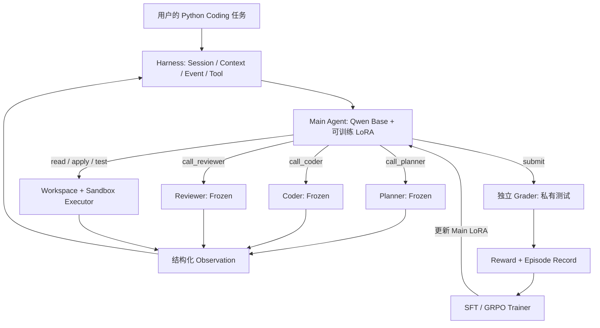

# CoPatch-RL｜完整项目设计与分阶段开发实施方案

> **CoPatch-RL: Learning to Orchestrate Coding Agents via Reinforcement Learning**  
> **副标题：** 基于可验证执行反馈的动态多智能体编程协作与 Main Agent 策略优化  
> **版本：** V2.0（工程协作修订版，2026-11-08）　**目标交付：** 2026-12-02　**团队：** 3 人　**新增现金预算上限：** ¥300（待实测后调整配置，不能擅自突破）  
> **定位：** 三人协作的 Coding Agent 工程、Agentic RL 训练与可复现评测；支持真实在线 LLM API  
> **状态说明：** 本文件是设计/实施方案，**不是已完成报告**。任何训练效果、耗时、费用、命令或指标，除非有对应运行记录，都属于目标、建议或待验证假设。

---

<a id="overview"></a>

## 〇｜项目一页总览（优先阅读）

> **一句话：** CoPatch-RL 是一个 **1 Main + 3 Frozen Sub-Agent** 的 Coding 系统：Main 根据任务和真实代码执行反馈，动态调用 Planner、Coder、Reviewer 或测试工具；采用 **SFT → Agentic GRPO** 只更新 Main 的 LoRA，最终以独立代码测试、协作效率与成本进行对照评测。**本节列出实施速查表；以下详细章节为唯一技术规范。**

### 0.1 架构总图（纯文本）

```text
                                  Python Coding Task
                                         │
                                         ▼
                        ┌────────────────────────────────┐
                        │       CoPatch-RL Harness       │
                        │  Agent Loop / Tool Registry    │
                        │  Session / Context / Budget    │
                        │  Event Store / SQLite Index    │
                        └───────────────┬────────────────┘
                                        │
                                        ▼
                        ┌────────────────────────────────┐
                        │       Main Orchestrator        │
                        │   Qwen Base (Frozen) + LoRA    │
                        │       仅 Main 接受训练          │
                        └───────────────┬────────────────┘
                                        │ 自主选择 Action
                   ┌────────────────────┼─────────────────────┐
                   ▼                    ▼                     ▼
             call_planner          call_coder           call_reviewer
             Planner Sub          Coder Sub           Reviewer Sub
              (Frozen)             (Frozen)              (Frozen)
                   └────────────────────┼─────────────────────┘
                                        │ Observation（真实输出）
                                        ▼
                      Main 决定：读文件 / 应用补丁 / 公开测试 / 再委派 / 提交
                                        │
                                        ▼
                        Workspace + Docker Sandbox
                               │                │
                         Public Tests      最终提交快照
                          (可见反馈)             │
                               │                ▼
                               └──→ Main    Private Grader（不可见）
                                                │
                                                ▼
                                             Reward
                                                │
                        ┌───────────────────────┴─────────────────────┐
                        ▼                                             ▼
                 SFT / GRPO Trainer                             Evaluation
                 Main-only Token Mask                         A/B/C/D + Ablation
                 Update Main LoRA                             Success / Cost
```

**固定 vs 动态：** 固定工作流由调度程序依次执行 `Planner → Coder → Test → Reviewer → Coder → Test → Submit`；动态工作流由 Main 每步决定要不要调用、调用谁、何时修复、何时停止。两者共用执行器与评分器，固定流程只作 Baseline。

### 0.2 组件、模型与开发责任速查

| 层次 | 组件 | 一句话职责 | 代码归属 | 首次形成 |
|---|---|---|---|---|
| 策略 | Main Qwen + LoRA | 选择工具/委派/终止；**唯一训练对象** | A：`training/`；B：`agents/main.py` | Stage 1 代码、Stage 2 训练 |
| 角色 | Planner / Coder / Reviewer | 规划 / 修改代码 / 审查；全程冻结 | B：`agents/` | Stage 1 |
| 运行时 | Loop / Tool / Session / Context | 控制多轮动作、上下文、预算与恢复 | B：`core/ harness/` | Stage 1 |
| 模型适配 | Local Qwen / Hybrid API | 相同接口切换本地冻结模型与在线模型 | B：`models/`；A：训练校验 | Stage 1 |
| 执行 | Workspace / Docker / Grader | 文件白名单、公开反馈、可信隐藏评分 | C：`execution/` | Stage 1 |
| 数据 | MBPP 转换 / 自建工程题 / Teacher 轨迹 | 产出真实任务、监督样本和评分资产 | C：`data/`；A：SFT 协议 | Stage 1 代码、Stage 2 数据 |
| 优化 | SFT / GRPO / Checkpoint | 只更新 Main LoRA，记录概率、mask 和权重 | A：`training/` | Stage 1 代码、Stage 2 实训 |
| 评测 | Single/Fixed/SFT/RL + 报告 | 统一条件下的正确率、成本与行为变化 | C：`evaluation/`；A：方法审查 | Stage 1 代码、Stage 3 正式结果 |
| 应用 | CLI / 轻量 Web | 演示真实在线协作与结果回放 | B：`app/` | Stage 1 |

**运行模式：** Local = 本地 Main + 本地 Frozen Sub（主训练和对照）；Hybrid = 同一 Main + 真实在线 Sub（应用演示和单独迁移对照）。**Local 与 Hybrid 结果不交叉归因**。

### 0.3 数据源、数据库与存储：什么阶段用什么？

这里把“**Benchmark 数据集**”和“**数据库/持久化系统**”分开。数据集用于出题、训练与验收；数据库用于保存系统运行状态，二者不是一回事。

| 阶段 | 数据或存储 | 简介与实际用途 | 放置位置 / 是否入 Git |
|---|---|---|---|
| 初始化 | 小型 Fake/Fixture 任务 | 手写最小 Python 测试案例，不依赖模型下载 | `tests/fixtures/`、`examples/dev/`，可提交 |
| **Stage 1** | **SQLite**（轻量关系型数据库） | 保存 episode/session 元信息、状态、预算、run 索引、资产登记；单机无需独立数据库服务 | `artifacts/state/copatch.sqlite3`，不提交数据文件，提交 schema/migration |
| **Stage 1** | **JSONL Event Store**（追加日志，非关系型数据库） | 逐行保存工具动作、Sub 输出、代码 hash 与错误；**原始事件为可回放依据**，SQLite 是可重建索引 | `artifacts/traces/*.jsonl`，仅脱敏示例入 Git |
| **Stage 1** | Workspace / Snapshot 文件 | 存当前候选代码、diff、提交快照；不应塞入数据库 BLOB | `workspaces/`、`artifacts/snapshots/`，不提交 |
| **Stage 1 合并后** | 模型资产索引与本地目录 | 负责人统一下载一次做接口验收，登记模型 revision、hash、逻辑路径和下载命令；每位成员在自己的设备单独下载 | `docs/ASSET_REGISTRY.md`、`configs/assets.example.toml` 入 Git；真实权重与本地设备路径不入 Git |
| **Stage 2** | **MBPP / MBPP+** | 公开 Python 编程题及增强测试；用于训练/验证/函数级保留集，必须核对源数据划分和版本 | `datasets/raw/` 不提交；`datasets/manifests/*.jsonl` 可提交 |
| **Stage 2** | 自建 Python 小工程集 | 数据处理、日志和配置任务，补足多步协作/审查价值 | 审核过的任务规格、允许公开的样例可提交，私测隔离 |
| **Stage 2** | SFT 轨迹 / GRPO Rollout | Main 决策样本；真实 token / logprob / mask / reward；体量较大可用 `.npz` / Parquet（列式数据格式，可选） | `artifacts/traces/`、`artifacts/datasets/`，默认不提交大文件 |
| **Stage 3** | Eval 结果 JSONL / CSV | 同一任务逐组结果、统计汇总、失败案例和绘图输入 | `artifacts/eval/`，提交脱敏小型摘要与复现脚本 |

**数据库决策：只要求 SQLite + JSONL + 文件系统。** Stage 1 实现 `schema_version`、初始化/迁移和断点恢复；SQLite 保存元数据与可重建查询索引，JSONL 保存原始事件，模型权重、源代码和大张量留在文件系统。**不需要 PostgreSQL、Redis、向量数据库、RAG 或云数据库。** 若一次写入中断，以已完整写入的事件记录为准恢复索引，不能假定 SQLite 和 JSONL 具有跨文件原子事务。

### 0.4 四组 Baseline、统一评测架构

| 组 | Main / 流程 | Sub-Agent | 研究问题 |
|---|---|---|---|
| **A：Single** | 一个 Coder 自主编码、测试、修复 | 只有 Coder | 单体 Coding 能力基线 |
| **B：Fixed MAS** | 确定性 `Planner → Coder → Test → Reviewer → ...` | 同一套冻结 Sub | 固定协作的收益与开销 |
| **C：Dynamic SFT** | Qwen Base + Main SFT LoRA 自主委派 | 三个冻结 Sub | 动态策略未经 RL 的表现 |
| **D：Dynamic GRPO** | C 的相同起点，经 GRPO 更新 Main LoRA | **与 C 完全相同的 Sub** | **主要比较 D–C：RL 是否提供增益？** |
| E（可选） | C 后继续 SFT | 同 C | 排除“仅多训练了一些步”的解释 |

```text
冻结 Test Manifest / Docker / Prompt / Sub Revision / 预算
                           │
                           ▼
             EvaluationRunner 顺序执行 A/B/C/D
                           │
             ┌─────────────┴──────────────┐
             ▼                            ▼
        每题最终源码                 全链路 Event/Cost
             │                            │
             ▼                            ▼
      独立 Private Grader            Metrics Aggregator
             └─────────────┬──────────────┘
                           ▼
         All-pass / Fix / Regression / Sub Calls / Cost
                           ▼
             分层报告、置信区间、失败与消融
```

**公平性要点：** 主比较 D–C 必须同 Task、同模型版本、同冻结 Sub、同 Harness、同工具与预算，只允许 Main LoRA 变化；Local 和 Hybrid 独立成表。不要将调用次数少直接等同于“有效委派”。

### 0.5 Benchmark 速查（不是所有数据集都适合直接训练编排）

| Benchmark / 集合 | 一句话介绍 | 在本项目中的用途 | 特别注意 |
|---|---|---|---|
| **MBPP** | 小型、带测试的 Python 编程题 | Train/Dev 的基础题目池，构造短任务 | 普通函数题未必体现 Planner/Reviewer 的价值 |
| **MBPP+** | 对 MBPP 部分题目的测试增强 | 函数级可信保留评测的一部分 | 需按源 MBPP ID 交集划分，不能直接相信数据集 `test` 字段 |
| **自建 12 个小工程题** | 数据、日志、配置各 4 个审核任务 | 检验多文件协作、修改与恢复策略 | 样本小，只作探索性工程迁移报告 |
| **Smoke/Dev Fixtures** | `count_positive` 等少量手写任务 | Stage 1 不下载任何真实模型就验证接口 | **不能算最终泛化成绩** |
| SWE-bench 系列（仅参考） | 真实仓库 issue 级修复基准 | 借鉴隔离、测试可信性、污染审计思想 | 本期不强制跑完整 SWE-bench |

### 0.6 三段开发放行图（**以门槛为准，不以日期替代验收**）

```text
Bootstrap（仅负责人）
  仓库 / README / AGENTS.md / 契约 / CI与文件所有权
                           ↓ 冻结接口
Stage 1（A/B/C 三人并行，各自 Worktree）
  全部项目代码：Harness、API、Sandbox、Data、SFT/GRPO、Eval、CLI/Web
  仅使用 Mock + 手写 fixture；不下载正式模型权重与完整数据
                           ↓ 各自提交 PR + 验收报告
  负责人审查合并 → 统一下载权重和数据 → 登记路径/版本/哈希
  → 真实接口 Preflight（不做正式训练）→ Stage 1 Gate
                           ↓
Stage 2（A/B/C 三人并行）
  数据验证与轨迹采样 → SFT → GRPO → 开发集调参 → 开发集对照
                           ↓ 负责人审查合并并冻结评测协议
Stage 3（A/B/C 三人并行）
  保留集最终评测、Hybrid 演示、复现脚本、图表/技术报告
                           ↓ 负责人最终审查合并与归档
```

**协作约束：** 一个主仓库、每人独立 `git worktree` + 分支、不同文件夹所有权；三人不在同一工作目录运行 Codex，也不直接向主分支推送。**Stage 1 是“全部代码完成”，不是“训练全部完成”；Stage 2 才下载后运行真实训练。** 权重不随 Git clone 分发，所有成员按资产登记自行下载。第 17–19 章附有分工、Prompt 与合并门槛。

---

## 全文目录（点击跳转）

> **建议先看上方 [项目一页总览](#overview)**，架构、数据库、Benchmark 和三阶段任务均已前置。

| 部分 | 对应章节 | 重点 |
|---|---|---|
| **I · 项目定位** | [第1章 项目目标](#ch1) · [第2章 前沿技术](#ch2) | 做什么、为什么做、从哪些论文/开源借鉴 |
| **II · 系统与 Harness** | [第3章 1+3 架构](#ch3) · [第4章 Harness](#ch4) · [第5章 双模式](#ch5) · [第6章 执行评分](#ch6) | Main/Sub、Context/Session、工具、模型与沙箱 |
| **III · 训练核心** | [第7章 数据](#ch7) · [第8章 SFT](#ch8) · [第9章 GRPO](#ch9) · [第10章 Reward](#ch10) · [第11章 LoRA与算力](#ch11) | 真实数据与轨迹、Main-only 梯度、成本预算 |
| **IV · 实验研究** | [第12章 对照](#ch12) · [第13章 指标](#ch13) · [第14章 消融](#ch14) · [第15章 报告](#ch15) | 证明策略是否有效、结果如何解释 |
| **V · 工程实施** | [第16章 仓库](#ch16) · [第17章 分工与 Worktree](#ch17) · [第18章 三阶段任务与 Prompt](#ch18) · [第19章 里程碑与风险](#ch19) | Bootstrap → Stage 1/2/3；三人并行、负责人合并与放行 |
| **VI · 交付** | [第20章 研究与应用交付](#ch20) | 在线 LLM 实证、真实训练、评测与技术报告 |
| **附录** | [A 参考资料](#annex-a) · [B 环境准备](#annex-b) · [C 数据契约](#annex-c) · [D 配置](#annex-d) · [E 排错](#annex-e) · [F 后续扩展](#annex-f) | 开工和复现时查阅 |

---

## 阅读导航：十分钟看懂本项目

**一句话：** 开发一个真正能够完成 Python 编程任务的 **1 Main + 3 Sub-Agent** 系统；由小模型 Main 负责**决定何时找 Planner、Coder、Reviewer，以及何时执行测试、修复和提交**，通过真实代码测试的可验证奖励，以 **SFT → Agentic GRPO** 训练 **Main 的 LoRA**，比较它是否比固定工作流和未强化学习的动态编排**更可靠、更省资源**。

**五个不变原则：**

1. **Coding 是最终任务**：交付可运行代码、测试结果和过程记录，不做泛化为通用办公助手的平台。
2. **只训练 Main Agent**：冻结 Qwen 底座和 Planner / Coder / Reviewer；RL 更新 Main 的 LoRA。Sub-Agent 是执行能力，不是本期的训练对象。
3. **动态协作是被优化的策略**：Sub-Agent 通过工具形式暴露给 Main，而非把 Planner→Coder→Reviewer 写成唯一的固定路线。
4. **真实环境给奖励**：执行器与独立隐藏测试负责判定代码正确性；不能靠模型自评，也不能伪造工具反馈。
5. **同 Harness、双运行模式**：Local（本地冻结 Sub-Agent，供 RL/主要研究）与 Hybrid（真实在线 LLM Sub-Agent，供应用/迁移验证）；两类数据和结论分开报告。

**三条流程容易混淆，请区分：**

- **应用流程**：用户需求 → Main 决策 → Sub-Agent/工具 → 测试 → 继续决策 → 提交代码。
- **训练流程**：训练任务 → 同任务多次真实 Rollout → 评分 → Group Advantage → 仅对 Main 的生成 token 计算 GRPO → 更新 LoRA。
- **实验流程**：冻结 Harness / 模型 / 题集 → 单 Agent / 固定协作 / 动态 SFT / 动态 GRPO 对照 → 结果与成本分析。

**验收优先级：** P0 = 必须完成的可运行应用；P1 = 主算法和研究评测；P2 = 预算允许时的拓展。**“已完成”必须附真实证据。**

| 交付目标 | 最低可验收证据 | 不应混淆的事情 |
|---|---|---|
| 在线应用验收（P0） | 在线 API 实际调用、可运行多角色 Coding 流程、CLI/Web、测试/异常/贡献记录 | 本地 mock 不能替代真实 API |
| RL 算法验收（P1） | Main LoRA 的 SFT 和至少一次真实 Agentic GRPO 更新、轨迹与奖励、可复现训练结果 | loss 有值 ≠ 训练有效 ≠ 泛化提升 |
| 研究与复现验收（P1） | 可审查的模块贡献、可信四组对照、任务级指标、失败分析、实验成本和复现方法 | 不可写尚未完成的提升幅度 |

**读者路径：** 开工先看第 0 节架构/数据/基线速查；开发直接读第 16–19 章；准备训练读第 8–11 章；评测与交付读第 12–15、20 章。

---

# 第一部分：项目定位、研究目标与技术选型

<a id="ch1"></a>

## 第 1 章｜项目概述与目标

### 1.1 简单说明：我们到底在做什么？

当用户提出“请修复一个 Python 项目的 CSV 解析错误”时，传统固定式系统永远先规划、再编码、再审查；但简单任务或某些错误可能根本不需要规划/审查，反而浪费时间和费用。我们想让 Main Agent 根据任务、当前代码状态、测试结果和剩余预算决定下一步行动。

一次可能的轨迹：`Main → Coder → run_tests(失败) → Reviewer → Coder(修订) → run_tests(通过) → submit`；另一次可能是：`Main → Coder → run_tests(通过) → submit`。**两种路线都应该是模型自主选择的结果，而不是在 Python 代码里按“任务难度”写死 if/else。**

本项目要回答的不是“多 Agent 能否写 Python”，而是：**RL 能否让小模型学到有价值的编排行为，并用最终代码成功率与全链路成本证明这一点？**

### 1.2 研究假设与可检验问题

- **H1 协作价值：** 固定多角色或动态多角色，在部分有信息瓶颈的任务上可能优于直接单 Agent，但并非总有收益。
- **H2 策略价值：** 相同 Main 底座、相同 Sub-Agent 与工具条件下，GRPO 训练的动态 Main 有机会优于仅 SFT 的动态 Main。
- **H3 成本价值：** RL 有机会减少无效规划、无效审查和重复编码，在可接受的正确率下提高资源效率。
- **H4 反馈价值：** RL 可能改变测试失败后的委派、修复和停止策略，而非只改变首次调用的角色。
- **H5 迁移假设（探索）：** 在不重新训练 Main 的情况下，接入更强在线 Sub-Agent 后，部分调度策略可能仍有效；**必须单独评估，不能保证。**

每条假设对应独立指标与消融。若失败，应报告失败原因及适用边界；“发现动态编排在简单任务上更贵”同样是有价值的实验发现。

### 1.3 三类成果的统一交付

| 面向 | 要交什么 | 成功标准 |
|---|---|---|
| Python 应用交付 | Python 工程、真实在线 LLM、多角色开发业务流程、文档/测试/视频 | 从自然语言需求到源码、公开测试、日志与可复现运行；三人贡献独立可查 |
| RL 算法交付 | MDP/部分可观测建模、真实 SFT、Agentic GRPO、策略与奖励、训练报告 | Main 的适配器确实被更新、底座与 Sub 均未被改动、轨迹与损失有效、对照可重现 |
| 研究成果交付 | 方法、系统、实验结果、成员模块贡献与代码仓库 | 能解释训练输入如何形成、梯度施加到哪、基线是否公平、提升与失败如何量化 |

应用交付要求包括：真实在线 LLM API、完整 Coding 流程、SPEC/PLAN/验收映射、自动测试、来源与成员贡献、结果对照及演示。**本报告只约束 CoPatch-RL 的技术验收，不涉及外部课程、机构或人员资料。**

### 1.4 范围冻结：本期做什么、不做什么

**本期范围：** Python 小函数与小仓库任务；1 Main + 3 Frozen Sub；轻量 Session/Context/Event Harness；工具调用和受控文件写入；Docker 执行、独立评分；SFT + GRPO 只训 Main；Local / Hybrid 两模式；四组基线与必要消融；CLI + 简单 Web。

**明确不做：** 动态“创造”任意新 Sub-Agent、训练所有角色、通用全桌面 GUI 自动化、复杂 RAG/长期记忆、全面分布式 RL、训练自己的 Qwen 底座、复制 OpenHands 平台、公开运行任意不受限 shell。工程目标应满足研究需要而非追逐功能数量。

### 1.5 决策冻结表与原方案差异

| 议题 | 旧版方案 | **最终共识（本版执行）** |
|---|---|---|
| 角色数 | Planner / Coder / Reviewer | **Main + Planner / Coder / Reviewer（1+3）** |
| 训练对象 | Coder LoRA | **只训练 Main LoRA**；Coder 冻结 |
| 编排方式 | 强约束固定三角色流程 | **Main 动态调用**；固定流程只作基线 |
| RL 优化目标 | 代码生成/修复决策 | **委派、测试、协作与停止策略**，最终仍以 Coding 成功衡量 |
| 模型运行 | 本地/在线混合的旧角色分配 | **Local：本地 Main+本地 Frozen Sub；Hybrid：本地 Main+在线 Frozen Sub** |
| 仓库 | 独立工程 | **新建仓库，选择性借鉴 其他仓库**，不把其作为运行依赖 |
| Harness | 工具与工作流为主 | 加入**Session/Context/Event/Checkpoint** 最小完整闭环 |
| 模型候选 | Qwen3-0.6B | 0.6B 用于烟测；正式优先试 1.7B / Qwen3.5-2B（兼容/费用门槛） |
| 评测 | Coder SFT/继续SFT/协作RL 四组 | **单 Agent / 固定 MAS / 动态 SFT / 动态 GRPO**；继续 SFT 作为补充控制 |

> **重要：** 以后如参考原始文档，请以上表为准。原版中的“只训 Coder”“提交前必须审查”等约束不能直接带进新版动态编排，否则会削弱研究对象。

---

<a id="ch2"></a>

## 第 2 章｜前沿思想与开源技术选型

### 2.1 简单说明：前沿技术怎样真正落到项目里？

“前沿”不是依赖列表越长越好，而是将近期可验证的研究问题落在自己能够实现的系统中。CoPatch-RL 的前沿位置主要在**动态多智能体编排 + Harnessed Agentic RL**，而非 ReAct、LoRA、GRPO 这些单独机制首次出现。

### 2.2 研究思想与项目落点

| 思想/研究 | 主要理解 | 本项目采用 | 不照搬的部分 |
|---|---|---|---|
| AOrchestra（ICML 2026） | 让智能体组织 Sub-Agent，而非只跑固定流程 | Sub-Agent-as-Tools；按反馈决定角色和顺序 | 自动生成任意新 Agent、复杂编排空间搜索 |
| MAS-Orchestra（ICML 2026） | 通过 RL 研究多智能体何时比单体有效 | 以任务结果优化协作选择；单/固定/动态基线 | 完整的整体 MAS 合成算法与大规模训练 |
| Agent Lightning v1.0（2026） | 真实 Harness 与训练器分离，保留工具、状态、上下文与轨迹 | Harness/Runner/Trainer 三层解耦 | 本期不强制部署其网关/集群全套设施 |
| Verifiable Reward | 用确定性执行检验输出，而非模型给分 | 私测与独立 Grader | 未审核的生成测试直接当真值 |
| Cost-aware Orchestration | 质量之外考虑调用次数和耗时 | 质量-成本双指标和可选成本奖励 | 只优化省钱而牺牲成功率 |
| Context / Event-based Harness | 历史可恢复、可回放，压缩不丢关键状态 | 主/子 Session、结构化事件、上下文摘要 | 跨项目长期记忆与巨大 KV-Cache 树 |

### 2.3 开源项目：只取最有用的一两点

| 项目 | 优先阅读的模块/机制 | 具体改造结果 | 定位 |
|---|---|---|---|
| [mini-SWE-agent](https://github.com/SWE-agent/mini-swe-agent) | 最小 Agent Loop、环境抽象、轨迹记录 | `core/agent_loop.py` 的清晰控制流、baseline | 代码范式借鉴 |
| [OpenHands SDK](https://github.com/OpenHands/software-agent-sdk) | Action / Observation、Event、Workspace、Condenser | 强类型动作/观察、上下文事件与回放 | 工程接口借鉴 |
| [AOrchestra](https://github.com/FoundationAgents/AOrchestra) | Sub-Agent 编排、委派方案 | `call_planner / call_coder / call_reviewer` | 设计理念 |
| [MAS-Orchestra](https://github.com/SalesforceAIResearch/MAS-Orchestra) | RL 编排与评测设定 | 动态调度策略、固定/动态消融 | 研究与实验设计 |
| [Agent Lightning](https://github.com/microsoft/agent-lightning) | Harness 对接 RL、Rollout 组织 | 真实轨迹采样与训练接口 | 架构借鉴 |
| [TRL](https://github.com/huggingface/trl) | SFTTrainer、GRPOTrainer、环境接口 | 真实 SFT / Agentic GRPO 梯度更新 | **实际训练依赖** |
| [PEFT](https://github.com/huggingface/peft) | LoRA/QLoRA 模型适配器 | 可训练参数、保存/重载 | **实际训练依赖** |
| 通用 Agent 工程设计范式（不引入其他仓库作为运行依赖） | Tool Calling、错误处理、模型适配 | 选择性迁移，重新验收与标注来源 | 旧代码经验来源 |

**引用与复用规则：** 先阅读官方仓库的当前 commit 与许可证；设计思想可重新实现，复制片段必须注明出处与许可；不能把开源系统的成绩当成 CoPatch-RL 的实验结果。开源项目是参考，不是所有都 `pip install`。

### 2.4 技术选型决策

- **基础：** Python 3.11、uv、Pydantic（契约）、pytest、Ruff、HTTPX、Typer；Streamlit 只负责轻量展示。
- **训练：** PyTorch + Transformers + PEFT + TRL；配置锁定版本；MLX 仅作可选 Mac SFT 探索，不能与 PyTorch/CUDA 的训练效果混报。
- **执行：** Docker 受限容器、可写源码工作区、独立隐藏评分器；初期不允许模型执行任意 shell。
- **持久化：** SQLite 运行索引 + JSONL 事件日志 + JSON 配置 + 源码快照；Stage 1 必须使用 SQLite（运行元数据/索引）+ JSONL（追加原始事件）+ 文件系统（源码快照/模型/张量），不需要数据库服务或向量数据库。
- **服务：** Local 与 Hybrid 共用同一 `ModelClient` 协议；供应商原生 tool call 与本地输出由适配器归一化。
- **开发：** 三人都可用 Codex 等 Coding Agent，但人类负责接口冻结、证据审查和研究结论。

---

# 第二部分：系统架构与 Agent Harness 设计

<a id="ch3"></a>

## 第 3 章｜整体架构：1 Main + 3 Sub

### 3.1 简单说明

**Main 负责决定“下一步找谁、做什么、何时停止”；三个 Sub-Agent 负责“把被委托的专业工作做好”。** 工具与评分器不是语言模型角色。Main 可直接请求文件查看、执行公开测试、调用某个 Sub、提交，不一定每次调用完整三人组。

### 3.2 逻辑结构



这是一张**训练视角**图：普通演示只运行到提交和评分，不会每个用户请求都自动更新 LoRA。在线 API 模式也可以纯推理，不参与训练。

### 3.3 四个角色的最小契约

| 角色 | 输入 | 输出 | 本期是否训练 | 约束 |
|---|---|---|---|---|
| Main | 当前任务、公开上下文、反馈、剩余预算 | 下一动作及结构化参数；最后 `submit` | **是** | 只能调用白名单工具，不能看私测 |
| Planner | 需求、公开仓库结构、可能已有反馈 | 简短计划、建议模块、风险点 | 否 | 不执行代码、不凭空宣布通过 |
| Coder | 任务要求、可写文件、具体编码指令、公开反馈 | 候选代码/补丁、简短说明 | 否 | 生成候选，不直接决定私测评分 |
| Reviewer | 需求、当前真实候选、公开测试 | 有证据的错误定位/保留建议 | 否 | 不能获取隐藏测试，也不直接提交 |

Sub-Agent **冻结参数，不等于固定答案**：它们会随任务和可见反馈输出不同内容；评测期间要固定模型版本、温度和提示模板。角色可共享同一冻结底座，但会拥有不同的系统提示和独立上下文。

### 3.4 动态编排到底是什么？

**固定 Baseline**（例）：`Planner → Coder → Public Test → Reviewer → Coder(必要修订) → Public Test → Submit`。此流程不依赖 Main 对调用顺序的策略决策，可由确定性调度器执行。

**动态实验**：Main 每步从 `call_planner / call_coder / call_reviewer / read_file / run_public_tests / submit` 中选择，能够跳过、重复或改变顺序，并指定交给 Sub 的任务与反馈。实际使用时应限制次数和总成本，避免无限循环。

**注意公平性：** 不能简单说“固定工作流 6 步、动态 20 步”就比较成功率。实验必须报告预算上限与真实消耗；固定流程的审查机会和动态流程的可调用工具尽量等价。完全相同的动作轨迹并非目标，**相同可用资源与评分条件**才是控制变量。

### 3.5 动作与阶段约束：既自主又不失控

建议初始动作集：

| 动作 | 示例参数 | 返回内容 | 必须检查 |
|---|---|---|---|
| `call_planner` | `goal, task_context` | `plan, risks, summary` | 参数长度与调用次数 |
| `call_coder` | `instruction, files, feedback` | `patch/code, note` | 路径、语法和可写范围 |
| `call_reviewer` | `code_hash, focus` | `issues, evidence, recommendation` | 审查内容对应当前代码版本 |
| `read_file` | `path` | 白名单内文件内容 | 路径防穿越、字节限额 |
| `apply_patch` | `path, patch` | 是否应用、当前 hash | 不改测试、不改私有资产 |
| `run_public_tests` | `test_suite_id` | 通过/失败数、公开错误摘要 | 限时限内存，测试版本与源码 hash 绑定 |
| `submit` | `reason` | 冻结最终快照、结束 | 提交后拒绝写入，不让隐藏结果回流 |

为降低第一版复杂度，可先让 Coder 输出**完整单文件替换**再升级补丁；但所有真实写入由 Harness 校验并完成，不让模型绕过白名单。**不要强制 Main 每次一定叫 Reviewer；否则“学会是否审查”将没有优化空间。** 可设置提交前至少完成一次公开测试的统一安全规则，并记录该规则对探索空间的影响。

### 3.6 完整任务示例（不是伪造的实验轨迹）

用户需求：“实现读取 CSV `amount` 列的统计工具，支持小数、空文件和非法数字报错。”理想运行过程可能是：Main 先阅读 stub → 调 Coder 生成 `csv_reader.py` 与 `stats.py` → 运行公开测试 → 收到 `0.25` 边界失败 → 调 Reviewer 核查阈值 → 调 Coder 修复 → 再测试 → 提交。**这一段只是用于理解的脚本示例**；正式训练使用系统实际采样、实际生成代码和实际测试结果。

### 3.7 接口与依赖层

`app → workflow.run_episode → (agents + model_client + harness + execution) → evaluation/grader → training`。

训练器不直接写应用文件；应用不直接调用 `optimizer.step()`；Grader 的私有测试不在 Main 的工具注册表里。这个边界决定了系统可维护性，也防止训练奖励被误当作模型观察。

---

<a id="ch4"></a>

## 第 4 章｜轻量但完整的 Agent Harness

### 4.1 简单说明：Harness 需要到什么深度？

它不是“LLM 调一个工具”这么简单。**一个能服务 Agentic RL 的最小 Harness，必须支持有状态交互、角色上下文隔离、可控执行、事件回放、精确训练轨迹。** 但不需要跨会话终身记忆、分布式消息总线和复杂数据库。

### 4.2 从 其他仓库 选择性继承

| 旧项目机制 | 处理方式 | 本项目新增要求 |
|---|---|---|
| Agent Loop / ReAct | 保留思想、按新契约改写 | Main 每步可委派不同角色，按工具观察继续 |
| Tool Calling / Dispatcher | 优先审查后迁移 | 类型化入参、权限、预算、完整动作追踪 |
| Model Client / 异常处理 | 可复用核心逻辑 | Local/Hybrid 双后端、训练原始 token 保真 |
| Context/历史记录 | **重新设计** | Main/Sub 分离、不可篡改事件、压缩与恢复 |
| 任务调度/固定工作流 | **重新设计** | 动态委派由 Main 决策、固定版单独基线 |
| MCP | 留适配层 | 本期最小 CLI 不依赖外部 MCP 服务 |

独立项目不通过 `sys.path`、符号链接、`pip install -e ../其他仓库` 运行；以项目自身源码及依赖锁可在干净目录重建为验收标准。

### 4.3 Agent Loop 与 Harness 的关系

- **Agent Loop**：获取模型输出 → 解析动作 → 校验 → 执行 → 生成观察 → 继续/终止。
- **ReAct**：一种“行动—观察—更新决策”的思路；不要求暴露或记录私有推理链，更不能把内部思考文本当作可验证事实。
- **Tool Calling**：动作传输与参数协议；模型仅**请求**执行，文件写入/测试由宿主控制。
- **Harness**：围绕 Loop 的会话、上下文、工具、工作区、安全、回放与训练数据基础设施。

### 4.4 Session Manager：每个任务是一棵小型运行树

建议 `episode_id` 为根，Main 的运行作为根 Session；每次 Sub 调用创建一个 `child_session_id`，记录 `parent_session_id`、角色、调用序号、输入摘要、模型版本与结果。**当前迭代只需一层父子关系**，未来才考虑任意深递归。

- `create_episode(task_id, config, policy_version)`：建立全新工作区与根事件。
- `start_sub_session(parent_id, role, args, code_hash)`：创建隔离子上下文。
- `append_event(session_id, event)`：追加事件，不覆盖历史。
- `close_session(status, usage, output_hash)`：收尾与错误归档。
- `resume_episode(snapshot_id)`：先支持执行层恢复；RL 训练中间恢复需还原采样/优化器状态，不能把不完整轨迹伪装成完整采样。

### 4.5 Context Manager：不是简单把聊天历史拼起来

推荐 `system role` + `TaskSpec` + `code snapshot summary` + `最近若干事件` + `必要引用` + `剩余预算` 的上下文组装方法。**Main 能看到的是公开观察；Sub 只看到自己的任务相关切片**。

| 信息类型 | Main 可见 | Sub 可见 | Grader 专有 |
|---|---|---|---|
| 用户需求、公开接口 | 是 | 与任务有关的部分 | 可引用 |
| 当前源码、公开测试反馈 | 是 | 调用时按需提供 | 可读取候选快照 |
| 其他 Sub 的全部历史 | 可经摘要/事件查看 | 默认不直接共享 | 不需要 |
| 剩余时间/Token/工具预算 | 是 | 本次调用预算 | 不需要 |
| 私有测试、期望值、参考实现 | **否** | **否** | **是** |
| 终局评分 | 训练结束后给 Trainer | **不回流到本局** | 是 |

压缩策略：保留任务约束、文件/代码 hash、最新公开测试状态、待办、真实工具错误、未解决问题；删减重复长输出，用 `summary_event` 标明压缩来源与版本。**原始事件永不丢弃，压缩只改变“模型看到的视图”，而不应重写历史。**

**训练关键点：** 为每次 Main 生成保存**当时实际输入的完整 token 前缀**（或能无歧义重建的消息/模板与 tokenizer revision）。不能事后用压缩后的摘要重新编码过去行动，然后声称对应原采样旧概率。

### 4.6 Event Store 与可回放性

JSONL 逐事件追加，至少包含：`event_id, episode_id, session_id, parent_id, step, timestamp, actor_role, event_type, policy_version, model_revision, request_id, action, observation, code_hash_before/after, token_usage, latency_ms, error_code`。本地训练额外保存 `input_ids / generated_ids / old_logprobs / generation_params / mask / stop_reason`（需要时放 sidecar 二进制文件并用 hash 引用）。

回放分两种：**事件回放**只展示历史结果，不重新调用 LLM；**执行重放**在相同快照/模型配置下重新执行以核对，模型随机输出不保证逐字相同。两者不能混淆。

**SQLite 最小关系表（Stage 1 必须实现）：** `episodes(episode_id, task_id, status, policy_version, created_at, closed_at)`、`sessions(session_id, episode_id, parent_id, role, status)`、`event_index(event_id, episode_id, session_id, jsonl_file, offset, checksum)`、`asset_registry(asset_id, revision, checksum, logical_path)`、`schema_migrations(version, applied_at)`。原始 JSONL 事件是事件事实记录；SQLite 提供快速检索与恢复索引。数据库异常时可基于通过校验的 JSONL 重建 `event_index`；不把 token 张量或私测正文存成 SQLite 大 BLOB。

### 4.7 Tool Registry 与调用权限

按“角色 × 工具”注册：Main 可使用委派和测试/提交工具；Planner、Reviewer 只产出建议；Coder 只生成候选或补丁。MVP 由 Main 决定是否应用补丁。执行层统一拒绝未知工具、参数缺失、路径越界、预算耗尽、提交后写入。

### 4.8 Workspace / Checkpoint

每局创建 `workspaces/<episode_id>/project`，保存源文件白名单、原始快照、每次修改 hash、提交时最终快照。训练检查点另存 `base_revision + adapter + optimizer + scheduler + sampler_state + rng_state + global_step + config`。**工作区快照与模型检查点是两类不同资源**；其关联以 `episode_id / policy_version` 为键。

### 4.9 完成标准

- Main 与 Sub 的历史互相隔离，Sub 不会意外读到隐藏测试；
- 每个工具动作能追溯到发起者、当前源码 hash、环境结果及费用；
- 会话断点可以从工作区快照恢复，失败被保留；
- 同一训练采样记录的 Main 原始 token/旧概率能与真实上下文对应；
- 非法路径、非法工具、超时、耗尽预算均有明确状态。

---

<a id="ch5"></a>

## 第 5 章｜模型选择与 Local / Hybrid 双模式

### 5.1 简单说明

**Main 是小模型政策网络，Sub-Agent 是被冻结的专业执行器。** CoPatch-RL 要求真实在线 LLM，因此不必把所有模型都放在本地：使用同一 Harness 切换 Sub 后端即可。

| 模式 | Main | Planner / Coder / Reviewer | 用途 | 是否参与正式 RL |
|---|---|---|---|---|
| Local | Qwen + Main LoRA | 本地冻结小模型，可共用模型权重但上下文独立 | 训练、算法与统计对照 | **是，优先** |
| Hybrid | 同一 Main / 训练后 LoRA | 真实在线 DeepSeek 或 GLM API | 在线应用与迁移对照 | 初期否，另行试点后才能训练 |

如果本地三个 Frozen Sub 不具备完成代码任务的最低能力，Main 会得到大量全零奖励。**先测 Sub-Agent 的独立可用性与不同协作路径之间是否有质量差异，再决定正式 RL 规模。**

### 5.2 模型候选与选择门槛

| 层次 | 候选 | 用途 | 启用条件 |
|---|---|---|---|
| 冒烟 | Qwen3-0.6B | 工具格式、LoRA 改变、训练链路连通 | 少量任务合法调用与梯度验证 |
| 主基线 | Qwen3-1.7B | 较可控的文本模型训练 | LoRA + TRL + 4090/MPS 试点成功 |
| 优先探索 | Qwen3.5-2B | Main 正式候选 | **先核实架构、Transformers/PEFT/TRL 支持、LoRA target_modules 与重载** |
| 备用升级 | 4B | 2B 无法有效决策时考虑 | 预算和显存允许，且原配置已可复现 |

Qwen3.5-2B 的公开模型卡可能涉及混合架构与多模态模型用法；**不要未经检查就把所有 Qwen3.5 模型当成与 Qwen3 文本 CausalLM 完全相同的类、tokenizer 和 LoRA 注入点**。我们只需要文本统筹，但训练实现要按对应架构核对。

### 5.3 ModelClient 统一协议

建议 `generate(role, messages, tools, config, trace_ctx) -> ModelResponse`；返回模型 ID、原始响应、标准化 Action、停止原因、Token usage、耗时及可得的采样元数据。**Local 的 Main 训练采样**需要精确 token IDs 和 old log-probs；**Hybrid API** 不保证返回这些字段，不能用在线日志拼成可反传的 Main 轨迹。

在线端：模型名称与厂商选项写配置，API key 仅环境变量，日志脱敏；独立处理限流、失败、断网、空输出；评测阶段记录实际返回模型名，禁止默默 fallback 到更强模型。

### 5.4 推理与采样条件

- SFT：使用每个 Main 决策对应的实际上下文，遵循官方 chat/tool 模板。
- GRPO：训练采样需要足够探索，记录 temperature/top-p/seed/token budget；旧策略在一次组采样与更新期间必须保持冻结。
- 正式评测：采用一致的确定性或固定随机策略（如贪心），控制调用预算、模型修订、Sub 温度与任务顺序。
- 每个调用设置输出上限；摘要压缩不能吞掉导致错误的关键工具反馈。

### 5.5 跨模型迁移评测

使用训练后 Main LoRA，**仅替换 Sub-Agent 后端**，在相同在线模型、相同任务、相同调用预算下比较“未经 RL 的 Main”和“经过 RL 的 Main”。只把它作为额外研究结果；在线模式通常更强，也可能更昂贵，不能把 Hybrid 成绩直接与 Local 成绩相减声称 RL 提升。


<a id="ch6"></a>

## 第 6 章｜Coding 环境、执行器和独立评分

### 6.1 简单说明：让“代码正确”成为可验证事实

系统有两个不同的程序：**CoPatch-RL 自身**（我们三人维护的 Agent 系统）与**Coder 生成的候选 Python 项目**（每个任务独立工作区）。候选程序不能覆盖 CoPatch-RL 自身，也不能访问私测、密钥或训练缓存。

原方案中单模块入门例子是 `count_positive(values)`，公开整数样例可以骗过错误实现 `x >= 1`；隐藏小数用例可以识别错误。这正是独立评分存在的理由。

### 6.2 任务类型与逐级扩展

| 类型 | 初始文件 | 期望输出 | 训练/评测用途 |
|---|---|---|---|
| F：函数实现 | 单文件 stub + 函数签名 | 正确函数 | SFT/GRPO 起步与算法定位 |
| B：边界与错误修复 | 有缺陷的代码 + 失败测试 | 修正代码，不引入回归 | 协作反馈和 Reviewer 价值 |
| M：小型多文件项目 | 2–5 个文件与约束 | 可运行项目及测试 | 强度更高的工程保留集 |
| R：小仓库定位修改（可选） | 受限小型 repo | 最小补丁和回归测试 | 迁移到 repo-level 任务的探索 |

**不能让难度仅靠代码行数衡量。** 应记录：文件数、需求条款、异常分支、输入类型、测试覆盖、任务描述歧义、跨文件依赖、典型首版错误率。简单题用于确保模型没有退化，中档题用于观察协作增益，困难题用于评估能力上界。

### 6.3 统一 TaskSpec 示例（设计示意，不是已存在源码）

```json
{
  "task_id": "dev_count_positive_001",
  "split": "dev",
  "task_family": "count_positive",
  "difficulty": "easy",
  "kind": "function_impl",
  "description": "统计有限实数列表中严格大于0的元素个数，空列表返回0",
  "entrypoint": "solution:count_positive",
  "allowed_files": ["solution.py"],
  "initial_snapshot": "snapshots/dev_count_positive_001",
  "public_suite_id": "public/dev_count_positive_001",
  "private_suite_id": "private/dev_count_positive_001",
  "budget": {
    "max_main_steps": 8,
    "max_sub_calls": 4,
    "max_public_tests": 2,
    "max_code_revisions": 2,
    "max_generated_tokens": 6000,
    "wall_time_seconds": 180
  }
}
```

`private_suite_id` 是**宿主评分器持有的索引**，不进入任何模型输入、工具 schema 或候选文件系统。`TaskSpec` 在宿主与模型视图之间要有明确的 `public_view()`，绝不可把完整 JSON 原样当 Prompt。

### 6.4 Workspace / Docker 安全执行

**禁止候选代码获得宿主自由执行能力。** 建议 Docker 无网络、非 root、受限 CPU/内存/PID、只挂载当前任务源码与必要公开资产；不要挂载整个宿主仓库、用户目录、密钥、Docker socket 或私测目录。不同 episode 独立目录/容器，完成后回收子进程与资源。对无 Docker 的 Mac 环境，必须先有 Docker daemon 并实测；仅安装 CLI 不算完成。

安全测试至少覆盖：文件路径 `../../` 越界、符号链接逃逸、恶意导入、死循环、无限输出、额外写测试文件、企图联网、长时间子进程未回收、语法错误、测试自身异常。**“Docker 已启动”不是隔离通过的证据**；需要反例测试和实际拒绝记录。

### 6.5 Public Test 与 Private Test 信息流

1. **公开测试**由 Main 主动调用，只返回预先允许的失败摘要、退出码、通过数和当前代码 hash；可以供 Main 继续决策。
2. **隐藏测试**由 Grader 在候选提交冻结后执行，完整测试脚本与预期值位于可信侧；候选只能处理本次输入，不可列出整套测试。
3. **训练奖励**由 Grader 向 Trainer 提供标量/状态，不将私测失败细节作为 Main 的当前轮观察。
4. **开发集**允许调试奖励和测试逻辑；**正式保留集**一旦冻结，不得用于重新选超参或补 SFT 示例。

对于 Python 函数题，初期可用 JSON 序列化的输入输出与独立进程调用。对复杂对象、临时文件和仓库任务，需明确输入契约/运行依赖，不得无限扩展执行表面。

### 6.6 提交与不可逆操作

`submit()` 返回成功仅表示**候选快照已被冻结**，不是代码已通过；后续 `write_file/apply_patch` 必须拒绝。达到动作预算、时间预算或不可恢复异常时自动终止，记录终止原因与实际失败。允许“提交有错代码”，但其奖励按评分给出，不应为演示好看无限重试。

### 6.7 先验收评分器，再接入模型

准备四个手写候选：正确、边界错误、语法错误、死循环。分别得到 `SUCCESS / TEST_FAILED / INVALID_CODE / TIMEOUT`（具体枚举由 Contracts 定义）。再检查评分侧中断会显示 `INFRA_ERROR`，而**不是把基础设施坏了误算成模型失败**。

---

# 第三部分：数据集、SFT 与 Agentic RL 训练

<a id="ch7"></a>

## 第 7 章｜数据集构造与任务分层

### 7.1 简单说明：训练集不是“直接让 AI 随便出题”

本项目需要**三种不同资产**：①可验证的 Coding 任务及测试；②经过真实运行的 Main 专家行为轨迹供 SFT；③从训练任务在线采样的多条完整 Rollout 供 GRPO。评测集独立冻结。**SFT 和 GRPO 可以使用同一训练任务池，但不能把保留集及其变体混进去。**

### 7.2 建议的数据来源和严格拆分

| 集合 | 初始来源/方式 | 用途 | 注意事项 |
|---|---|---|---|
| Train | MBPP 原训练区间（原方案 ID 601–974，按源数据版本核对），加审核的自建题 | SFT 与 RL 更新 | 不是所有公开题天然适合工具委派；需再做转换与检查 |
| Dev | MBPP 原验证区间（原方案 ID 511–600）和独立开发题 | 调试、选模型/超参、确定任务难度 | 可以反复看，但不得最后声称“从未见过” |
| Held-out F | MBPP+ 与 MBPP 原测试区间（原方案 11–510）交集并按源题去重 | 单模块最终测试 | 数据集网页的 `test` 标记不代表源 MBPP 原测试集 |
| Held-out M | 12 个独立小项目（数据/日志/配置各 4 题，原方案保留） | 工程迁移 | 作者/审查者分离；结果单独成表 |
| Smoke | `count_positive` 等 4–8 个反复调试题 | 快速端到端验收 | 绝对不能作为最终泛化指标 |

**原规划数量不是承诺：** 本地试点可用 32/8/40，云端目标可扩成 80/24/80，但新版动态 MAS 的采样成本更高。先审核有效题目、完成全链路测量，再冻结规模；不能在看见保留集成绩后筛选题目。

### 7.3 为“统筹策略”专门设计任务

仅有“求和、排序、素数”会让 Main 学到总是叫 Coder，Planner/Reviewer 几乎无用。**不能刻意制造提示暗示答案，但应确保数据包含不同协作价值的自然任务：**

- **直接委派合适：** 需求清晰、短函数、公开测试覆盖主要输入。
- **规划可能有效：** 多需求条款、多个相关文件、接口约束易冲突。
- **审查可能有效：** 首版存在边界错误、异常处理问题、数据格式细节。
- **重试可能有效：** 公开失败给出可以修复的错误位置和原因。
- **不应重试：** 当前代码正确、Reviewer 提供无关建议；正确终止是可学习行动。

“可能有效”需**由开发集上的真实多策略试验验证**，而非按类别人工断言。不同任务类型至少记录一次直接/规划/审查路径是否能区分结果，避免 GRPO 全零/全一组。

### 7.4 数据结构与 Manifest

推荐 `datasets/manifests/{train,dev,test}.jsonl`，每行至少：`task_id, family_id, origin, origin_revision, license, split, kind, difficulty, requirement_hash, snapshot_hash, public_suite_hash, private_suite_ref, reference_hash, allowed_files, review_status, author/reviewer`。私有资产单独路径存放；Git 仓库公开时不上传带密钥、个人隐私及不允许公开的测试资产。

**同源去重：** 不仅按完整字符串，还按函数签名、AST/模板结构、问题语义与源题 ID；同题改变量名、缩进、常数不应跨 Train/Dev/Test。同一个开源 benchmark 的公开参考和底座预训练污染风险需要在报告中披露。

### 7.5 AI 辅助造数据的正确流程

可以让更强 LLM 负责生成**候选题目、初版实现、规划/审查示范**，但必须经过：

`草案 → 人工审核规范 → 可信参考实现 → 独立测试 → 多轮真实执行 → 轨迹完整性校验 → 加入数据清单`。

生成测试必须检查是否与规格一致、是否覆盖反例、是否依赖随机环境；不能用生成模型的口头“通过了”代替 pytest/Grader。Teacher 可能知道某些公开参考答案，因此要记录教师、提示、筛选标准及污染风险。

### 7.6 数据质量关卡

- 题目可被标准库或明确锁定依赖实现；
- 参考实现通过完整可信测试；
- 错误例子能被私测抓住、正确例子不会因测试错误失败；
- 输入输出和异常语义不歧义；
- 训练前冻结 split 与版本哈希；
- 训练数据可以保留失败轨迹作分析，但不能把成功轨迹中的私测信息写入模型观察；
- 评分基础设施错误与候选失败分别统计。

---

<a id="ch8"></a>

## 第 8 章｜SFT：生成并监督 Main 的协作行为

### 8.1 简单说明：SFT 教会 Main “合法、有效地调度”

不是让 Main 学会输出 Python 源码，也不是训练 Planner/Reviewer 的表达风格。SFT 的监督标签是**Main 在某个真实上下文下选择的行动**，例如 `call_coder(...)`、`run_public_tests()`、`call_reviewer(...)`、`submit()`，包括合理的参数和委派指令。

### 8.2 一条 SFT 样本应该长什么样？

```text
[公开上下文]
系统身份：Main coding orchestrator
任务：修复 CSV 金额解析，支持小数与非法输入
当前状态：Coder 已提交候选版本 hash=abcd；公开测试失败1/5
工具观察：ValueError ... 发生在第17行
剩余预算：2次委派，1次公开测试

[监督目标：只训练 Main 这一段]
call_reviewer({"code_hash":"abcd","focus":"定位第17行金额解析失败"})
```

下一轮 Supervisor 输入应包含**Reviewer 真正运行产生的回答**，再监督 Main 如何调用 Coder 修复。**不能把多个真实时刻随意拼成一个不存在的上下文。**

### 8.3 四类核心示范

| 类型 | 目标行为 | 是否需要真实执行 |
|---|---|---|
| 直接完成 | `call_coder → public_test → submit` | 是 |
| 有效规划 | `call_planner → call_coder → test → submit` | 是 |
| 反馈驱动修复 | `call_coder → test失败 → reviewer/repair → test → submit` | 是 |
| 正确止损/终止 | 已正确时不被无效意见带偏；超预算时停止 | 是，至少验证场景有效 |

建议保证不同类型覆盖，而不是全部采样成功的固定“Planner→Coder→Reviewer”链。某些任务可以故意加入无帮助审查意见的开发对照，让 Main 学会检查证据，而不是盲目多叫 Agent。

### 8.4 数据生产：Teacher + 真实 Frozen Sub-Agent

1. 由强 Teacher Main 或人工编排生成行动（可使用在线 API 额度）；
2. **由目标训练/评测条件中的真实 Sub-Agent 和真实工具执行动作**，生成 Observation；
3. 存下每轮的 Main 输入、Teacher 动作、子调用返回、代码 hash、公开测试与终局分数；
4. 通过完整性、正确性与成本审查，挑选可学习的优质轨迹；
5. 将成功轨迹中的 Main 行动抽成监督样本，同时保留真实上下文与可选失败分析；
6. 固定训练数据版本和 Teacher 模型版本；同一来源任务不跨 split。

注意：**用 Hybrid Teacher + 在线 Sub 生成的协作轨迹，直接用于 Local Frozen Sub 的 SFT 可能造成“观察分布不匹配”**。最佳做法是优先在对应 Local 环境采集示范；若混用，明确记录来源并验证目标 Local Main 能用得起来，禁止伪装成同分布。

### 8.5 Loss Mask 与样本打包

SFT 以 Main 的生成 token 为标签，其余全部 `labels=-100`（或框架等价 ignore index）：TaskSpec、角色提示、Sub 回答、工具 observation、公开测试都只是条件。多次 Main 行动可逐步形成多训练样本；如按整局拼接，必须保证 role 边界、每轮上下文和生成目标都正确。使用官方 chat template 时，应通过单元测试验证 label 对齐、tokenizer 特殊符号及工具 JSON 的实际编码。

**负例单元测试：** 在一条“Main→Coder→Main→Reviewer”的记录里，将 Coder 输出替换为明显字符串，验证对应 token 仍不参与 Main 梯度；打乱 Main 标签必须导致测试失败或 loss 变化。

### 8.6 SFT LoRA 参数起点（待试点）

| 参数 | 起步建议 | 启用前核验 |
|---|---|---|
| `r / alpha` | 8 / 16 | 参数注入位置实际存在、trainable 参数数目正确 |
| `target_modules` | Qwen3 文本模块可试 `q_proj,k_proj,v_proj,o_proj` | Qwen3.5 需按模型架构查证，不能盲抄 |
| 学习率 | `1e-4` 起步 | 观察 loss/梯度、验证集是否退化 |
| epoch | 1–2 起步 | 数据规模与过拟合诊断 |
| 最大上下文 | 例如 2048–4096 token | 预算/记忆占用、长工具反馈截断行为 |
| batch | microbatch 1 + gradient accumulation | 实际显存与吞吐 |
| 模型底座 | 冻结 | checksum 或逐参数一致性验证 |

先在 4–8 条样本上尝试**可控过拟合测试**：loss 有限、有效标签 token 数 >0、LoRA 权重前后不同、Base/三 Sub 不变、重启进程后可加载并输出合法工具动作。完成后再扩大 SFT；超参是可调整建议，不是已验证“最佳配置”。

---

<a id="ch9"></a>

## 第 9 章｜Agentic GRPO：在真实协作中训练策略

### 9.1 简单说明：从“照着示范做”到“真实尝试后改进”

**GRPO 不是拿一个代码结果直接微调答案。** 同一道训练题从相同初始工作区出发，使用**当前 Main 策略**独立采样多次，每次 Main 可委派、调用工具和修复，最后得到验证奖励；通过组内相对优势使表现较好的**Main 决策 token**更可能出现。

### 9.2 形式化建模（可写进 RL 作业）

- **状态/隐藏状态：** 任务真值、工作区源码、测试资源、执行状态、剩余资源，私测信息对 Main 隐藏。
- **观察 `o_t`：** 公开任务描述、可见源文件、历史公开工具反馈、Sub 返回、预算及上下文摘要。
- **动作 `a_t`：** Main 生成的一段可解析的委派/工具请求及参数，或提交/停止。
- **转移：** Harness 执行动作、更新代码与预算，冻结 Sub 产生有条件返回，公开测试产生观测。
- **奖励 `R(τ)`：** 独立 Grader 对最终代码的测试与约束得出的标量，可加成本项。
- **策略 `π_θ(a_t|h_t)`：** `Qwen_base + Main_LoRA_θ`，输入为当时的实际可见历史 `h_t`。
- **Episode：** 从任务/快照 reset 到提交、预算耗尽或终止的一次完整决策轨迹。

由于隐藏测试和其他未观测因素存在，更严谨地可以称**部分可观测、多步交互决策过程**。本期只优化 Main 的一套策略参数，**不属于多个可训练 Agent 同时做 MARL**。

### 9.3 Rollout 的可实现流程

```text
for each selected train task x:
  freeze Main policy version θ_old for this update
  for i in 1..G:
    reset independent workspace with identical task/snapshot/env_seed
    until submit / step cap / timeout:
       construct actual Main context h_t
       sample Main action with θ_old; save exact generated token ids + logprobs
       validate action, execute tool or Frozen Sub-Agent
       save immutable observation and policy-visible feedback
    lock final snapshot; independent grader computes R_i
    save entire trace with group_id, policy_version, cost, reason
  calculate grouped advantages A_1..A_G
  compute GRPO loss on Main generated token segments only
  optimizer.step() on Main LoRA; save checkpoint and diagnostics
```

`G` 是**同一道题从同一初态出发的独立轨迹数**，而不是不同题的混合。每条轨迹独立工作区；环境随机性应可控并记录；生成不必相同。组采样期间旧策略参数不应在中间改变。

### 9.4 奖励与组相对优势

主奖励先用二值全通过：

$$R_{\mathrm{pass}}(\tau)=\mathbf 1[\text{提交合法，最终快照通过全部可信验收测试}]$$

同组 `G` 条轨迹奖励 `R_i`，一个常见组内优势形式为：

$$\bar R=\frac1G\sum_{i=1}^{G}R_i, \qquad A_i=\frac{R_i-\bar R}{\mathrm{std}(R_1,\ldots,R_G)+\delta}.$$

例如 `[1,0,1,0]` 会产生正负学习信号；`[0,0,0,0]`、`[1,1,1,1]` 几乎没有组内任务区分信号。若所有组全零，**先排查工具合法率、子 Agent 能力、题目难度、奖励器和 SFT，而非盲目加大梯度或篡改评分**。

### 9.5 策略损失与重要性比率（示意）

每个 Main 生成 token 的新旧策略概率比 `r_t(θ)=π_θ(y_t|h_t)/π_old(y_t|h_t)`。典型 clipped policy objective：

$$\mathcal L(\theta)=-\frac1{GC}\sum_{i=1}^G\sum_{t\in\mathrm{MainTokens}(\tau_i)}\min\left[r_{it}(\theta)A_i,\;\operatorname{clip}(r_{it}(\theta),1-\epsilon,1+\epsilon)A_i\right].$$

这里 `C` 是所选固定 token 归一化上限（具体要与使用的 TRL loss type 对齐），`ε` 可从 `0.2` 起步。**实际公式与代码要以锁定版本的 TRL 为准**：不同版本/`loss_type` 的长度归一化、组标准差和 KL 行为不完全相同，不能只写一个名词“GRPO”就视为正确。

### 9.6 最重要的技术问题：跨角色轨迹的梯度归属

一条完整轨迹可能为：

```text
Main token: call_coder({instruction: ...})         ← 训练
Coder token: def parse_csv(...): ...               ← 冻结环境观察，不训练
Main token: run_public_tests()                    ← 训练
Executor result: 3 passed, 1 failed               ← 工具观察，不训练
Main token: call_reviewer({focus: ...})            ← 训练
Reviewer token: 错误位于空文件处理                  ← 冻结环境观察，不训练
Main token: call_coder({fix: ...})                  ← 训练
Main token: submit()                               ← 训练
```

**绝不能对整条字符串直接求语言模型交叉熵。** 每段 Main 输出必须保存角色、生成时的完整上下文、原始 token IDs、旧 logprob、策略版本和有效 mask。工具观察与 Sub 生成文本是下次行动的上下文，但对当前 Main policy loss 的 mask 为 0。

重要细节：一次 Agent Episode 内多个 Main 调用往往对应**多个独立模型生成前缀**。不能假设它们可以无损拼成一个连续的自回归 token 序列。应逐生成段计算 `π_θ(y_t|h_t)`，再按完整 trajectory 的共同优势聚合损失；旧概率必须与采样时的**相同 token、相同前缀**对应。

### 9.7 训练器与 Harness 的边界

推荐：`TrainingAdapter.reset(task_row)` 创建 Episode/Workspace；`rollout()` 复用真实的 `run_episode`；结束后由外部 `Grader.score(snapshot, task_id)` 获得标量奖励；`GRPOTrainer` 或自定义 rollout adapter 读取可训练 token 段，完成一次更新。TRL 的 `tools / environment_factory / rollout_func` 等接口随版本演进，**在 POC 阶段读取锁定版本 API 签名与官方例子后选一条，而不是同时实现三套**。

特别注意：不要将 `get_reward`、私测路径、调试评分等暴露成模型可调用工具；所有 Train/Dev/Test 的隐私边界由环境控制。

### 9.8 初始 GRPO 配置（候选，不是测量）

| 条目 | Smoke / Local 起点 | Cloud 试点起点 | 注意 |
|---|---|---|---|
| 底座 | Qwen3-0.6B → 1.7B | 1.7B 或 3.5-2B | 每次只改变一个主要因素 |
| Group size | 2 | 4（显存允许时） | 组内应有不同 reward 才有比较信号 |
| 训练步数 | 先 1 步真实梯度 → 20 步 | 试点后再确定，如 50–100 步 | 不保证在预算内完成所有组合 |
| RL 学习率 | `5e-6` 起步 | 试点扫描 | 比较梯度与 reward，不盲追训练曲线 |
| LoRA | `r=8, alpha=16` | 同架构复制起点 | 保留 SFT checkpoint 作共同初始化 |
| Clip / KL | `ε=0.2`；是否 `beta=0` 需对齐代码 | 先低成本、再调稳定性 | 关闭 KL 不等于没有旧策略比率 |
| 采样 | 合理温度、原始 token 保真 | 与硬件实现一致 | 训练采样与评测解码分开 |
| 种子 | 42、43（计划） | 两个独立种子 | 指标分别列出，不抹平差异 |

### 9.9 真实参数更新的五条证据

1. `base_model` 冻结；只有 Main LoRA 参数在优化器里；Sub 模型参数无梯度、无更新。
2. 至少一个完整训练任务产生不同结果的真实轨迹，且评分独立可信。
3. 有效 Main token `mask` 不为空，旧/新 logprob 对齐，无 NaN/Inf。
4. `optimizer.step()` 后 Main adapter 权重变化，能够保存、重新加载并继续推理。
5. 逐条记录实际运行时间、显存、失败率和 reward；训练完成后再对 Dev/保留集进行公平评测。

---

<a id="ch10"></a>

## 第 10 章｜Reward Design 与学到什么策略

### 10.1 简单说明

想训练“更聪明地统筹”，不能只把“少调用 Agent”作为胜利。先以正确性为主；确保 Main 不会为了省调用直接提交错误代码，然后再研究质量-成本权衡。

### 10.2 奖励分层

**Phase A，最稳健的主实验：** `R = 1[最终代码合法且全部隐藏测试通过]`。正确率与成本**分开报告**，避免奖励权重掩盖质量退步。

**Phase B，开发集消融：** `R = R_pass - λ·C_norm`，其中 `C_norm` 可来自统一定义的 Token/API/时间预算归一化成本，且必须在训练前固定 `λ`。如果奖励出现大量负数、模型学会跳过任务等异常，回退 Phase A。**正式论文式报告不能在看见保留集后临时调 λ。**

### 10.3 不宜使用的“看似简单”奖励

- “Main 调用了 Planner 得 +0.1”：会诱导无意义规划；
- “Reviewer 说代码很好 +0.2”：主观、可被迎合，不是代码正确；
- “工具次数越少分越高”：可能直接提交或拒绝工作；
- “公开测试通过就满分”：公开样例可能过浅，应以私测最终验收为主；
- “提交前调用 Reviewer 才有奖励”：破坏是否委派的动态研究空间。

可用**合法性/超预算规则**作为硬约束：无效提交=0，模型调用预算耗尽=0；但 infra error 应单列并可控重试，不能打成候选失败。

### 10.4 我们想观察的策略变化

| 行为现象 | 可以记录什么 | 不能据此直接得出的结论 |
|---|---|---|
| 简单题减少 Reviewer 调用 | 按难度分层调用率、成功率、费用 | 不能单凭调用下降断言“学会推理” |
| 测试失败后再调用 Planner | 错误类别→后续行动转移矩阵 | 不能仅由相关性推断 Planner 产生因果效果 |
| 有效调试后及时提交 | 修复率、过度修订率、工具预算 | 不能只展示成功轨迹 |
| 移除 Reviewer 后改变策略 | 替代工具使用、成功/成本变化 | 需要固定其他条件才可解释 |

### 10.5 主指标与奖励的关系

主实验成功指标使用严格的**最终全通过率**，训练奖励可为 0/1。另报 pass@k（如果有多样本）、修复率、回归率、每成功任务成本、失效和超时率。为了避免通过很多公开测试而碰巧骗过简单私测，工程集应增加异常、边界和回归用例审核。

---

<a id="ch11"></a>

## 第 11 章｜LoRA、训练资源与云端执行

### 11.1 简单说明：实际更新什么？

训练中的参数关系是：

$$\theta_{\mathrm{base}}=\mathrm{frozen}, \quad \theta_{\mathrm{Main-LoRA}}^{\mathrm{init}} \xrightarrow{\mathrm{SFT}} \theta_{\mathrm{SFT}} \xrightarrow{\mathrm{GRPO}} \theta_{\mathrm{RL}}.$$

最终部署：`Main = 固定 Qwen 底座 + 训练后的 Main LoRA`，再加**固定 Harness 与 Frozen Sub-Agent**。Qwen 不会因为 LoRA 获得无限的专业代码知识，项目主要研究的是模型**怎样调用已有能力**。

建议保存三份明确版本：原始 Base（不纳入大权重仓库）、SFT Adapter（比较基线）、GRPO Adapter（研究结果）；另保存 optimizer 与 progress 用于继续训练。训练与推理启动时验证 Base revision、Tokenizer/chat template 与 Adapter config 配套。

### 11.2 Mac 与云端角色分工

| 环境 | 推荐承担 | 风险 |
|---|---|---|
| Apple Silicon（可选本地开发设备） | 开发、API/本地推理、最小 LoRA/SFT 测试、轨迹检查 | MPS + TRL 具体算子兼容性未知；全套多轮 GRPO 可能很慢 |
| RTX 4090 / CUDA | 正式 1.7B–2B LoRA、RL 小规模训练 | 24GB 显存受上下文、多条 rollout、并行子模型影响 |
| 32GB 或 80GB GPU（可选） | 4B 或长序列/复杂采样试点 | 超预算风险明显增加 |
| 在线 API | 真实在线 Sub-Agent 和迁移评测 | API 花费与 rate limit；不能直接训练供应商权重 |

**在线 Sub 的费用不能按 0 估算**；若本地 Sub 推理慢，也必须将 Sub 推理总耗时纳入 Rollout 成本。单卡 4090 训练 Main 与多个本地 Sub 可能争抢 GPU，必要时冻结 Sub 使用 CPU/异步服务或分时调用，并实测吞吐。别因为 LoRA 只训练 1–2B 就认为整个流程一定便宜。

### 11.3 先用“小实验”测真实耗时，再决定训练规模

从 8 道 Train + 4 道 Dev 开始：

- 记录每条轨迹 Main 生成 token、每个 Sub 的输出、公开测试次数与耗时；
- 对比 0.6B / 1.7B / 2B 的合法工具调用率和具体训练兼容性；
- 完成 1 次**真实完整 rollout → reward → 有限梯度 → optimizer step → LoRA 保存/重载**；
- 记录 `cost_per_episode`、`seconds_per_optimization_step`、峰值设备内存/显存、每个失败类型；
- 按真实时间 × 任务 × 组大小 × 超参/种子次数估算总费用，**额外预留等待、评测和失败重试**。

把“一个 GRPO step 是几条轨迹、几个模型请求和几次工具执行”写清楚；不能只估每个 `optimizer.step()` 的 GPU 时间。

### 11.4 新增支出预算上限（原方案保留、内部可重分配）

| 用途 | 上限（元） | 实施策略 |
|---|---:|---|
| GPU 兼容试点 | 20 | 非量化、短序列优先 |
| SFT / 继续 SFT | 30 | 先完成共同 SFT 基线 |
| GRPO 正式训练 | 120 | 两种子优先，小规模并验证轨迹 |
| 评测与复核 | 40 | 正式集与可重复运行 |
| 存储/传输 | 20 | 大权重不入 Git，实验资产归档 |
| API 补充额度 | 20 | 优先用已有额度，真实付费照实记 |
| 机动 | 50 | 升级模型/排错/重跑应急 |
| **合计** | **300** | **现金新增支出，不含已拥有额度的折算使用价值** |

单价随平台和时间变化，不能将之前讨论的“4090 约每小时若干元”写成合同价。租用前登记：平台、实例型号、显存、区域、价格/计费粒度、实际启动至停止时间、失败重试；**预算固定，训练规模不固定**。

### 11.5 风险回退顺序

1. **模型/框架问题：** 先在 0.6B 或 1.7B 复现可训练路径；再尝试 2B；Qwen3.5 架构不兼容时不用硬上。
2. **资源不足：** 先减上下文长度、组大小、可训练并行数，再减少非必要实验；不牺牲评分隔离。
3. **奖励没有差异：** 调试任务与可用能力、诊断格式错误；不要挑选最终测试题人为制造显著提升。
4. **时间不足：** Python 在线应用与真实单次训练证据必须保留；减少 UI 花哨效果、模型规模与超参网格。
5. **所有 GRPO 组都失败：** 如实报告训练无稳定提升，保留完整结果；不能把已完成 SFT 展示为 GRPO 效果。


---

# 第四部分：评测体系、实验设计与成果分析

<a id="ch12"></a>

## 第 12 章｜对照实验：证明 RL 优化的是什么

### 12.1 简单说明：不要把“多了模型”与“学会统筹”混为一谈

四组实验是整个项目从 Demo 变成研究型项目的关键。最重要的比较不是“RL MAS vs 只有一个弱模型”，而是**在同样 Harness、同样 Frozen Sub、同样任务与预算下，动态 Main 经 GRPO 后是否比相同 SFT Main 更好**。

### 12.2 正式四组与主要假设

| 组 | Main 与编排 | 角色 / 模型 | 回答的问题 |
|---|---|---|---|
| **A：Single Agent** | 不使用独立 Main/委派网络，单个冻结 Coder 自己写、读测、修复 | Coder 单角色，使用同等工具 | 最朴素 Coding Agent 能做到什么？ |
| **B：Fixed Multi-Agent** | 确定性调度器执行固定 `Planner→Coder→Test→Reviewer→Coder(必要时)→Test` | 与动态组相同 Frozen Sub | 固定协作本身的价值和费用？ |
| **C：Dynamic SFT** | Main 运行时选择委派/测试/提交 | Base + 共同 SFT LoRA；三 Frozen Sub | 不经过 RL 的动态编排如何？ |
| **D：Dynamic GRPO** | 与 C 完全同一 Harness/动作集合 | 同一 SFT 起点 + GRPO LoRA；三 Frozen Sub | **GRPO 对策略产生了什么增量？** |

**主比较：D − C。** 这可以较直接地估计在固定编排空间与冻结执行器下，RL 策略更新的效果。**B − A** 是协作组织与费用的参考，**C − B** 是自主动态编排与固定调度的比较，但不能把所有差别都归因于 RL。

### 12.3 补充“继续 SFT”控制组

可新增 **E：Dynamic Continued-SFT**：从 C 的共同 SFT 检查点出发，继续监督训练，保持同样动态 Harness；与 D 比较时尽量报告相近的更新次数、有效 token 和 GPU 时间。**目的：排除“多训练了一会儿自然更好”的解释。** 不应称两者算力严格相同（Agentic GRPO 的 rollout 环境成本与监督学习不同）。若预算不够，E 为 P2，必须说明因何未做。

### 12.4 实验条件怎样控制？

**必须固定：**

- `task_ids / snapshot_hash / public_suite_hash / private_suite_hash`；
- Main Base 模型版本、Tokenizer、工具 schema；组 C/D 除 LoRA 权重外相同；
- Planner/Coder/Reviewer 的模型、Prompt、温度、输出上限与日志版本；
- 文件白名单、Docker 镜像 digest、测试接口与错误处理规则；
- 可用工具集合、最大调用/Token/时间预算、终止协议；
- 最终评分器、统计方式、任务顺序（可按种子打乱后对所有组保持同序）。

**成本必须完整报告：** Main token、三个 Sub token、工具执行、重复失败、固定流程中即使预生成缓存的计划也必须声明成本如何摊销。A 组没有 Main 的额外 token，不能隐去这部分差异。**“相同上限 + 比较真实消耗”通常比硬规定每条轨迹调用完全相同次数更适合此研究。**

### 12.5 正式冻结实验协议

在看最终 Test 之前固化 `eval_protocol.json`：模型/checkpoint 哈希、四组定义、split/ID、预算、评测解码、随机种子、指标分母、失败处理、统计方法。修改协议必须提升版本号并保留旧版本结果；**不能在最后 12 题中找到几个难题后临时移出**。

### 12.6 Local 与 Hybrid 不是第五和第六个“可直接混比”的组

Local 模式内运行 A–D 是主要研究。Hybrid 模式另做至少 C/D 的配对对照：相同在线 Sub、相同 API 配置、相同任务、相同预算，仅 Main 权重不同。**严禁用“Local C vs Hybrid D”宣称 RL 提升**；那可能只是换了更强 Coder。

### 12.7 两种子与统计功效

若预算允许，D 至少两次独立 RL 训练种子（例如 42/43）；每条任务保留配对结果，报告逐种子均值与范围。任务级配对 bootstrap 可估计成功率差区间；**12 道小工程题只能做探索性展示，不能用极小差异支持很强的显著性宣称**。如果两种子方向相反，应如实说明不稳定。

---

<a id="ch13"></a>

## 第 13 章｜量化指标与数据分析

### 13.1 简单说明：指标要能回答四类问题

① 写对了吗？② 学会了什么委派行为？③ 花了多少钱和时间？④ 训练过程是否真的有效？若只有一个“平均 Reward”，无法回答这些问题。

### 13.2 Coding 正确性指标（主指标）

| 指标 | 定义 | 分母/注意事项 |
|---|---|---|
| **Final All-pass Rate** | 最终提交通过完整可信测试的源题数 / 总题数 | **主要成功指标**，不能按测试断言数凑分 |
| Initial Pass Rate | 首次生成候选是否正确 | 需要明确首次候选与最终代码 hash |
| Fix Rate | 首版错误且最终修复成功 / 所有首版错误的任务数 | 分母为 0 记 NA |
| Regression Rate | 首版正确但最终改坏 / 所有首版正确任务数 | 分母为 0 记 NA |
| Public/Private Gap | 公开与私测通过差异 | 检查边界盲区及公开测试过拟合 |
| Invalid/Timeout Rate | 非法动作、语法错、超时、预算耗尽等比率 | 失败类别分别展示，不能都归为“模型错” |

### 13.3 统筹与委派指标

| 指标 | 计算方式 | 解释范围 |
|---|---|---|
| Sub-Calls per Task | 每题 Planner/Coder/Reviewer 次数及分布 | 描述行为，不等于好坏 |
| Delegate Selection Rate | 按任务难度与当前反馈状态统计下一次动作 | 反映策略是否随环境变化 |
| Useful Delegation（谨慎定义） | 反事实固定前缀下调用与不调用的成功率/成本差 | 需要干预实验，不能用主观打标签 |
| Replanning/Review After Failure | 测试失败后再次委派的比例 | 需结合修复成功率解释 |
| Early/Correct Stop | 正确候选后及时提交、无效重复修订数 | 奖励效率与质量平衡 |
| Tool Validity | 合法动作数 / Main 生成动作数 | SFT/模板/训练可靠性诊断 |

例如“Reviewer 只调用了 0.8 次”不是成功；必须看到任务成功率不退化或单位成功成本下降，且不能靠违反停止约束得分。

### 13.4 成本与可靠性

每题记录：Main 与各 Sub 的输入/输出 token、可得的 reasoning token、API 按供应商价格折算费用、总工具调用、容器 CPU 时间、端到端 wall-clock 时间、GPU 训练时间。推荐报告：

- **Cost per Attempt**：总费用 / 题数（包含失败与超时）；
- **Cost per Success**：全部尝试费用 / 成功题数（成功数为 0 → NA）；
- **Success at Budget**：在固定预算上限内的成功率；
- **Cost–Success Frontier**：多预算条件下成功率与真实费用/耗时的折中。

以 Token 计费的在线 API 与本地 GPU 租金属于不同成本口径，应在总表分列 `cash_cost`、`imputed_api_cost`、`gpu_runtime_cost`，不要把已有免费额度偷偷当成零实际算力。

### 13.5 RL 训练诊断

每次训练步记录：平均 reward、`reward_std`、有效组占比、all-zero/all-one 组比例、policy loss、clip fraction、生成长度、Main 有效 token 数、训练梯度范数、学习率、最大内存、rollout 秒数、optimizer 秒数、checkpoint 名称。若启用 KL，记录真实 KL 估计并检查参考策略版本；未启用就不画“KL 改善”。

### 13.6 报告格式

建议生成：`eval/per_task.jsonl`（每题每组）、`eval/summary.json`（总指标）、`eval/splits.csv`（分层）、`eval/cost.csv`、`eval/failures.md`（失败类型与案例）、`eval/plots/*.png`（独立图）、`eval/protocol.json`（冻结配置）。展示每个比较的样本数、成功数、失败数、两个种子、区间；**不只显示挑出来的最佳 case**。

---

<a id="ch14"></a>

## 第 14 章｜消融与因果解释

### 14.1 简单说明

GRPO 可能提高分数，但原因可能是模型调用更少、模型变得更保守、工具格式更合法，甚至偶然采样。消融的任务是**区分这些解释**。

### 14.2 最值得做的消融（按优先级）

| 优先级 | 实验 | 固定条件 | 解释的问题 |
|---|---|---|---|
| P1 | **D vs C：GRPO vs SFT** | 相同 Main Base / Frozen Sub / Harness / 任务 | RL 是否提供增量？ |
| P1 | **D vs B：动态 RL vs 固定 MAS** | 相同冻结角色和预算 | 动态 RL 是否优于固定调度？ |
| P1 | **去掉 Reviewer** | 其余角色与测试不变，同一任务 | Main 是否依赖审查、会否采用替代路径？ |
| P1 | **去掉 Planner** | 其余相同 | 规划角色是否有独立价值？ |
| P2 | `R_pass` vs `R_pass - λ·cost` | 训练设置尽量一致 | 成本意识是否损害代码正确率？ |
| P2 | 同模型不同大小 | 其他尽量一致 | 更大 Main 是否改善编排决策？ |
| P2 | Local → Hybrid | 固定线上 Sub | 统筹策略是否迁移？ |
| P2 | Continued-SFT 控制 | 相同动态架构 | RL 改善是否超过追加监督训练？ |

### 14.3 最有说服力的“协作效用”实验

对同一任务、相同**中间前缀**（例如 Coder 初版及公开失败反馈）、同一 Frozen Coder 与修订预算，分别提供“没有审查意见 / 原始 Reviewer 意见 / 打乱的意见”，比较后续修复成功率与费用。此实验可以检验 Reviewer 反馈是否真的有帮助，而不是只看动态轨迹中 Reviewer 出现的频率。**需要分开计算“首版错后修对”与“首版对后改错”。**

### 14.4 失败结论如何写？

- **D ≈ C：** 可能 SFT 已学到主要策略、任务太简单、奖励信号不足；报告标准误与组内优势而不是编造显著性。
- **D 成功率↑但费用↑：** 学会更积极委派，质量收益要与成本共同评估。
- **D 费用↓但成功率↓：** 策略可能只会节省而不会成功，不应称“优化完成度”。
- **Local 好、Hybrid 差：** 策略迁移依赖 Sub 能力/反馈分布，具有环境适配局限。
- **两个 RL 种子波动大：** 训练尚不稳定；建议扩大样本或改进奖励，但不得看最终测试调参。

---

<a id="ch15"></a>

## 第 15 章｜最终研究报告与结果呈现

### 15.1 简单说明：最终要形成“证据链”

**系统可运行 → 模型确实训练 → 冻结评测 → 指标变化 → 原因与局限。** 这条链比“训练跑完了”和“有 Demo 界面”更有可复现的技术价值。

### 15.2 报告建议结构

1. 问题背景：为什么固定多智能体调度不够，以及为什么优化 Main 的动作策略；
2. 方法：1 Main + 3 Frozen Sub、状态/动作/轨迹与 Harness；
3. 训练：任务数据、SFT、GRPO、LoRA、奖励与关键超参；
4. 实验：四组定义、硬件、模型/软件版本、预算控制；
5. 结果：独立 Task Pass、Fix/Regression、调用成本、失败与区间；
6. 机理讨论：行为分布、实际案例、去 Reviewer/Planner 消融；
7. 局限：小样本、公开 benchmark 污染、Sub 能力、预算与 RL 训练稳定性；
8. 复现：代码 commit、模型 revision、数据 manifest/哈希、环境配置、命令与产物。

### 15.3 每张图必须回答一个问题

| 图/表 | 回答的问题 |
|---|---|
| Fig 1 系统架构 | Main 究竟如何与 Frozen Sub 和 RL Trainer 交互？ |
| Fig 2 真实 Rollout | 一条完整的动态协作轨迹怎样发生？ |
| Fig 3 SFT/GRPO 训练曲线 | 策略学习信号有没有？是否稳定？ |
| Table 1 四组最终成功率 | RL 在公平基线上是否有可测增量？ |
| Fig 4 成功率—成本图 | 优化是否只是“增加模型调用”？ |
| Fig 5 按难度分层的角色调用 | 模型在不同任务上如何改变委派？ |
| Table 2 消融 | Planner、Reviewer、奖励权重究竟发挥了什么作用？ |
| Case Study 成败轨迹 | 为什么好/坏？证据和限制是什么？ |

### 15.4 结果模板（占位，禁止填虚构数字）

```markdown
| Condition | Task Count | All-pass (%) | Fix Rate (%) | Cost / Task | Sub Calls | Notes |
|---|---:|---:|---:|---:|---:|---|
| A: Single | TBD | TBD | TBD | TBD | 0 | Frozen Coder baseline |
| B: Fixed MAS | TBD | TBD | TBD | TBD | TBD | fixed flow |
| C: Dynamic SFT | TBD | TBD | TBD | TBD | TBD | trained Main LoRA |
| D: Dynamic GRPO (seed 42) | TBD | TBD | TBD | TBD | TBD | RL |
| D: Dynamic GRPO (seed 43) | TBD | TBD | TBD | TBD | TBD | RL |
```

所有指标必须来自同一正式 `eval_protocol.json` 对应的真实输出。成绩提高多少、平均调用降低多少等在获得独立保留集数据前**一律不预填**。


---

# 第五部分：工程实施、团队协作与阶段验收

<a id="ch16"></a>

## 第 16 章｜仓库结构、核心契约与工程规范

### 16.1 简单说明：先把可协作的边界定好，再让 Codex 并行写代码

三个人都使用 Coding Agent，意味着**写代码可以很快，但接口冲突也会更快出现**。正确做法是先由 A 固定少量公共契约，再由 B/C 在自己目录里并行实现，逐阶段运行测试与集成。

### 16.2 建议最终目录（按阶段出现，不要第一天创建大量空壳）

```text
CoPatch-RL/
├── README.md
├── AGENTS.md                   # Codex 共享工程约束（与本文第17章一致）
├── pyproject.toml              # Python 3.11, project.scripts
├── uv.lock                     # 锁定的依赖
├── .gitignore                  # 排除密钥、模型权重、临时workspaces等
├── docs/
│   ├── SPEC.md                 # 需求和范围
│   ├── PLAN.md                 # 三阶段里程碑与依赖
│   ├── OWNERSHIP.md            # 目录归属、PR/Worktree规则
│   ├── ASSET_REGISTRY.md       # 模型及数据下载版本和相对路径
│   ├── handoffs/               # 三阶段各成员独立交接记录
│   ├── ADR/                    # 关键架构决策
│   ├── CONTRIBUTIONS.md        # 三人贡献及AI辅助说明
│   └── ACCEPTANCE.md           # 需求→验收命令→证据
├── src/copatch_rl/
│   ├── contracts.py            # 公共Task/Action/Observation/Record契约
│   ├── core/
│   │   ├── agent_loop.py       # 借鉴旧项目，新的主循环
│   │   ├── registry.py         # 工具和角色注册
│   │   └── budget.py           # Token/动作/时间预算
│   ├── models/
│   │   ├── base.py             # ModelClient 协议
│   │   ├── local_qwen.py       # 本地采样与token保真
│   │   └── api_client.py       # DeepSeek/GLM等在线适配
│   ├── agents/
│   │   ├── main.py             # Main决策入口
│   │   ├── subagents.py        # 三种Frozen角色及调用
│   │   └── prompts/            # 角色与工具Prompt版本
│   ├── harness/
│   │   ├── session.py          # 主/子Session与父子关系
│   │   ├── context.py          # 角色可见视图/压缩
│   │   ├── events.py           # JSONL Event Store
│   │   ├── state_db.py         # SQLite 元数据/可重建索引及迁移
│   │   ├── workflow.py         # run_episode和终止协议
│   │   └── checkpoints.py      # 会话与工作区快照
│   ├── execution/
│   │   ├── workspace.py        # 文件白名单和快照
│   │   ├── sandbox.py          # Docker受限执行
│   │   ├── public_tests.py     # 公开反馈
│   │   └── grader.py           # 独立私测评分（不暴露给Agent）
│   ├── data/
│   │   ├── ingest.py           # 数据集导入
│   │   ├── dedupe.py           # 同源/语义去重
│   │   ├── validate.py         # 参考和测试质量
│   │   └── trajectories.py     # SFT数据生产和校验
│   ├── training/
│   │   ├── model_setup.py      # Main底座、LoRA、冻结检查
│   │   ├── sft.py              # SFT
│   │   ├── rollout.py          # 真实Episode采样与token保真
│   │   ├── grpo_adapter.py     # TRL接口/策略损失mask
│   │   ├── reward.py           # 奖励编排，读取Grader结果
│   │   └── checkpoint.py       # Adapter/Optimizer/RNG
│   ├── evaluation/
│   │   ├── conditions.py       # A/B/C/D对照的冻结配置
│   │   ├── runner.py           # 成批运行
│   │   ├── metrics.py          # 成功、委派、成本、统计
│   │   └── reports.py          # JSON/表格/报告
│   └── app/
│       ├── cli.py              # run/train/evaluate/inspect 等
│       └── web.py              # 可选Streamlit界面
├── tests/                      # 单元/集成/安全测试，含 fixtures/（测试本系统）
├── examples/dev/               # 公开开发任务
├── datasets/manifests/         # 冻结任务ID与split；raw/不入Git
├── grader_assets/              # 独立私测资产：不挂载给模型
├── configs/                    # local/hybrid/sft/grpo/eval/assets示例配置
├── scripts/                    # 下载/校验/复现实验脚本
├── workspaces/                 # 每局候选源码；gitignore
└── artifacts/
    ├── traces/                 # Session事件、RL原始轨迹
    ├── adapters/               # LoRA与训练状态
    ├── eval/                   # 对照/消融结果
    └── reports/                # 图、技术报告与视频素材
```

**文件所有权（全阶段不变）：** A 独占 `contracts.py`、`training/`、全局配置/锁文件、`README.md`、`AGENTS.md` 与主分支；B 独占 `core/`、`harness/`、`agents/`、`models/`、`app/`；C 独占 `execution/`、`data/`、`evaluation/`。测试文件按 `test_training_*` / `test_harness_*` / `test_execution_*` 等前缀分属 A/B/C；跨模块改动提变更请求给所有者，详见第17章。

### 16.3 公共契约（定义稳定，内部实现可以调整）

```python
# 伪接口说明：正式实现时以Pydantic模型/Protocol和测试为准
run_episode(task: TaskSpec, config: RunConfig) -> EpisodeRecord
ModelClient.generate(role, messages, tools, config) -> ModelResponse
SessionManager.start_child(parent_id, role, args) -> SessionId
ContextManager.build_view(session_id, role, token_budget) -> list[Message]
ToolRegistry.execute(action: Action, scope: ToolScope) -> Observation
Executor.run_public_tests(workspace_id, suite_id) -> PublicTestResult
Grader.score(submitted_snapshot_id, task_id) -> GraderResult
TrainingAdapter.sample_group(task_id, policy_version, group_size) -> list[Trajectory]
EvaluationRunner.run(condition_id, task_manifest) -> EvaluationReport
```

**必不可少的类型字段：**

- `TaskSpec`：任务 ID、family/split、可见需求、快照、可写文件、测试索引、预算、源版本；
- `Action`：`tool_name`、经过校验的参数、目标角色/路径、Main step；
- `Observation`：成功/失败、允许暴露的内容、时间、当前代码 hash、剩余预算；
- `EpisodeRecord`：任务 ID、run/episode/group/session ID、模型/策略版本、事件序列、最终快照、奖励、费用、错误类型；
- `Trajectory`：各 Main 生成段的 token、旧 logprob、上下文引用、Main mask、真实环境观察；
- `ModelResponse`：请求/返回模型、原始 tool call、归一化动作、生成参数、停止原因、usage 与可得的训练元数据。

### 16.4 错误规范与服务边界

统一错误枚举：`INVALID_ACTION, PERMISSION_DENIED, MODEL_ERROR, API_RATE_LIMIT, TOOL_ERROR, TEST_FAILED, TIMEOUT, BUDGET_EXHAUSTED, INFRA_ERROR, SUBMITTED`。**动作是否合法与候选测试是否正确是两类不同状态**。每个异常留 `error_type, message, cause, safe_feedback, episode_id`；私测错误不得进入 `safe_feedback`。

### 16.5 版本与复现规范

每次实验记录 `git_commit, uv_lock_hash, python_version, torch/transformers/trl/peft_versions, base_model_revision, adapter_hash, prompt_hash, dataset_manifest_hash, docker_image_digest, configs_hash, device_info, seed`。模型权重不进 Git；提交 lock、脚本和 README；日志中的密钥/个人路径需脱敏。

### 16.6 单元测试不是任务成功率

`tests/` 验证自己的 Harness/训练适配是否实现正确；`public/private tests` 验证 Coder 生成的候选程序是否正确。**两种测试不能混成同一个 pass rate**。主要测试集应分为：契约、事件恢复、工具权限、容器安全、在线 API mock/真实调用、模型冻结/LoRA、rollout token/mask、奖励完整性、评测配对与统计。

### 16.7 全员统一 Python 代码风格（写入根目录 `AGENTS.md`）

**目标：代码少绕弯、可读、可测试、改动边界小。** 以 Python 3.11、标准库优先和 PyTorch 原生写法为基础；不为了“架构高级”制造额外抽象。

| 项目 | 统一要求 |
|---|---|
| 命名 | 模块/变量/函数 `snake_case`，类 `PascalCase`，常量 `UPPER_SNAKE_CASE`；业务命名描述含义（`policy_version`, `code_hash`） |
| 结构 | 小函数、单一职责；**状态真实存在时使用类**（如 SessionManager），无状态逻辑用普通函数；禁止无意义继承、过度工厂化 |
| 类型 | 公共函数全部有 type hints；模块内部用 `dataclass` 或普通类，**跨模块输入/输出边界**用 Pydantic（如 TaskSpec/Action） |
| 风格 | 4 空格缩进、双引号、行宽 100；提前返回、显式分支、关键逻辑加短注释；Docstring 解释“为什么/边界”，不复述函数名 |
| 导入 | 标准库 → 第三方 → 本项目，明确模块导入；不使用 `from x import *`，不改 `sys.path` 逃避打包 |
| 异常 | 使用明确异常/状态码，不写裸 `except:`，不捕获后静默吞错；不能把私测、密钥写进日志 |
| 工程 | 用 `pathlib.Path`、`logging`、结构化事件；配置从配置文件和环境变量读取，不硬编码本地设备绝对路径 |
| Async | 只有实际 I/O 并发需要才引入 `async`；禁止随意混合同步/异步接口和副作用 |
| RL | LoRA/Mask/Reward/LogProb 张量 shape 与 dtype 显式检查；必须有数值单测；算法公式由代码/锁定版本支撑 |
| 修改 | 只改自己负责的目录，最小 diff；不得擅改 `contracts.py`、`pyproject.toml`、`uv.lock`、冻结协议 |
| 质量门槛 | `ruff check`、`ruff format --check`、`pytest` 均通过；测试覆盖有效路径、边界输入、失败与恢复 |

**明确禁止：** 大量空壳类、把 Mock 当真实调用、用硬编码成功结果冒充评测、把从未执行的日志拼成训练轨迹、自动切换模型不留痕、提交大权重/原始私测/API Key。

**统一配置：** 将 `line-length = 100`、`target-version = "py311"` 等 Ruff 约束写入 `pyproject.toml`；根目录 `AGENTS.md` 放简明的协作规范（本次另附可直接复制的模板）。对已通过测试的代码不做无关重构。


---

<a id="ch17"></a>

## 第 17 章｜三人协作：独立 Worktree、文件所有权与合并审查

### 17.1 一句话原则

**负责人 A 初始化项目、冻结公共接口；三人每阶段并行开发互不重叠的模块；每个人交 PR + 测试证据；A 统一审查、合并并发布下一阶段的基线。** 不让三个 Codex 在同一目录同时改代码，不以“最后 Git 能 merge”为协作规划。

### 17.2 三人模块所有权（每阶段沿用）

| 人员 | 唯一负责的代码范围 | Stage 1：全部代码 | Stage 2：训练与开发集 | Stage 3：最终评测与交付 |
|---|---|---|---|---|
| **A：架构与训练负责人** | `src/copatch_rl/contracts.py`、`training/`、`scripts/assets/`；根目录 `README.md`、`AGENTS.md`、`pyproject.toml`、`uv.lock`、全局配置；`tests/test_training_*` | 初始化后补齐 SFT/GRPO/采样/Checkpoint 完整代码及 Mock 单测，审查所有接口 | 统一下载并验收资产；执行 Main LoRA SFT/GRPO，本地/云端试点、调参、训练对照 | 锁定模型/算法版本、解释结果，最终审查与报告合并 |
| **B：Harness 与在线应用** | `src/copatch_rl/{core,harness,agents,models,app}/`、`tests/test_harness_*`、`tests/test_models_*`、`docs/demo.md` | **完成完整应用代码**：1 Main + 3 Sub、Agent Loop、Session/Context、SQLite/JSONL、ModelClient、Hybrid API、CLI/Web、固定工作流 | 真实 Local/Hybrid 模型联调、Context/Session 恢复、异常排查；只修自己模块 | Hybrid 在线真实演示、录屏脚本、应用复现与故障说明 |
| **C：Environment / Data / Eval** | `src/copatch_rl/{execution,data,evaluation}/`、`tests/test_execution_*`、`tests/test_data_*`、`tests/test_eval_*`、`examples/dev/` | **完成全部环境与评测代码**：Workspace、Docker、Grader、数据导入/去重/验证、指标计算与 Baseline Runner | 数据下载校验、Manifest、Teacher/真实工具轨迹质量审核、Reward 核对和 Dev 指标 | 冻结保留集实际跑分、统计图表、失败案例、可复现性复核 |

**A 管理公共契约、版本锁和合并；B/C 有修改建议时写 ADR/PR 评论，由 A 统一调整，不能顺手跨目录修改。** 各负责人可以用自己的 Coding Agent 编写代码，但必须真人复核 diff、测试与任务结论。

### 17.3 Git worktree 推荐方案（唯一优先协作方式）

核心是**独立工作目录 + 独立分支 + 目录所有权**。首次 clone 后，在每位成员本地设备分别执行以下命令（示例分支名，具体远端按仓库配置）。

```bash
# 初次获取代码；每位成员在自己机器上执行
# git clone <REPO_URL> CoPatch-RL
cd CoPatch-RL
git fetch origin

git switch main
git pull --ff-only

# 每人只创建属于自己的 worktree，避免共享同一工作目录
# A 示例
git worktree add ../CoPatch-RL-A -b stage1/a-training main

# B 示例（由 B 在自己的本地设备执行）
git worktree add ../CoPatch-RL-B -b stage1/b-harness main

# C 示例（由 C 在自己的本地设备执行）
git worktree add ../CoPatch-RL-C -b stage1/c-eval main
```

> 上述 A/B/C 命令是三种**互斥示例**，并非要求某个成员在同一台机器创建所有目录。`<REPO_URL>` 须换成实际仓库地址。下一阶段重新从 A 已合并的 `main` 创建 `stage2/*`，Stage 3 同理。若已存在分支，使用对应的 worktree 增加/切换流程，不重复 `-b`。

**提交与审查协议：**

1. A 在阶段开始创建 Tag（如 `stage1-base`），发布契约版本、对应 Commit、允许修改范围和验收清单。
2. A/B/C 各自在自己的 Worktree 完成任务；每个 Commit 只修改归属模块及对应测试。`AGENTS.md` 为所有 Codex 统一规范。
3. 每人运行局部测试、Ruff、相关集成测试；提交 `docs/handoffs/stageX_{a|b|c}.md`（由各自分支新增独立文件）。
4. 各自 `git push -u origin <stage-branch>` 后发起 PR，从 `stageX/{a|b|c}-...` 指向 `main`，附变更摘要、commit、测试输出、Mock/真实证据区别、未完成项和风险。
5. **A 统一 review → 检查越权改动 → 按依赖顺序合并 → 全量复测**；失败则退回责任人修复，不在主分支边调边合并。
6. 三个 PR 全通过才标记 Stage Gate，创建 `stageX-accepted` Tag；Stage 2/3 只能基于已接受的 Commit 开发。

若模块边界确实需要共享文件改动：责任人提交**接口修改申请**（目的、影响、兼容测试），A 在主分支统一更新契约并通知另外两人 rebase 后继续。不要用 `--force` 覆盖共享分支，不要靠复制整个目录互相覆盖。

### 17.4 统一验收与交接文件格式

每人必须提交简明交接文件，以下字段不能省略：

```text
Stage / Owner / Branch / Base commit / Final commit
本阶段目标与实际完成范围（完成 / 未完成）
修改文件清单（仅归属目录）
新增或更改接口（关联 ADR / 契约版本）
实际验证命令与退出码（Mock / Local / Hybrid 标注）
证据路径：日志、测试、报告、trace、demo
阻塞问题、重现步骤与已知风险
是否下载过模型/数据（Stage 1 工作分支必须是“否”）
```

**不接受的交付：** 只给“功能已完成”文字、空壳函数、没有真实测试输出、把缺失模型的 Mock 结果称真实性能、未经批准修改通用接口或大规模重构其他成员文件。

### 17.5 负责人合并检查顺序

推荐 `C（Workspace/Grader） → B（Harness/Model/App） → A（Training/Integration）`，并不是因为 C 重要性低，而是训练最终依赖真实执行和完整轨迹。三个 PR 应在 Stage 基线内共同验证。每次合并后跑 `uv run pytest`、`uv run ruff check src tests`、`uv run ruff format --check src tests`，并检查 `git diff --name-only`、`git status`、依赖锁与 `.gitignore`。

**关键安全门槛：** 对 Stage 1 的 Docker 隔离失败、私测泄漏、Main-only token mask 错误，直接否决放行；这些问题不能靠 Stage 2 调参修复。

---

<a id="ch18"></a>

## 第 18 章｜Bootstrap + 3 个 Stage：职责、Prompt、验收与合并门槛

### 18.1 新实施方案概览

原文档 原技术步骤 是技术**依赖路径**，现在合并为**3 个团队协作阶段**。每一阶段包含较多开发任务，由 A/B/C 同时推进，**每一阶段结尾统一审查合并**。原有技术章节 3–15 仍然是实现标准，不因阶段压缩而删减。

| 时段 | 主要目标 | 各成员独立交付后 | 负责人统一做什么 |
|---|---|---|---|
| **Bootstrap（A 独立）** | 仓库、README、AGENTS.md、Contracts、目录约束与 CI | 不需要 B/C 同时修改 | 发布 `stage1-base`、共享最小 Mock fixture |
| **Stage 1：全部代码开发** | **完整系统代码**：1+3、Harness、CLI/Web、Local/Hybrid、Executor/Data/Eval、SFT/GRPO；先不下载模型权重/完整数据 | 三个可合并 PR + 全套 Mock/单元/安全/接口合同测试 | 审查合并；**然后由 A 统一下载权重和数据并建立登记、运行真实接口 Preflight**；通过才进 Stage 2 |
| **Stage 2：实训与开发集实验** | 固定正式模型/数据，真实 SFT→GRPO、Dev 调参与 A/B/C/D 开发集对照 | 训练日志+Checkpoint、数据 QC、工具/评分结果 | 整理训练证据、审核失败、合并修复、冻结最终评测协议 |
| **Stage 3：正式评测与报告** | Held-out 测试、必要消融、在线演示、复现、图表与报告 | 完整真实结果、演示与复现证据 | 最终合并、复现审核、报告归档和版本发布 |

**核心边界：Stage 1 要把程序写完、接口以 FakeClient 走通；不是下载模型后就做完项目。Stage 2 才允许大规模真实数据构建和正式 LoRA 训练。** Stage 1 Gate 的少量模型/数据下载与真实请求是“加载与接口验收”，不属于训练阶段。

### 18.2 Bootstrap｜由负责人 A 独立初始化（在 B/C 动手前完成）

**目的：** 三个 Coding Agent 必须从同一个契约与规范开始；一旦进入并行开发，不能每个人自己发明 TaskSpec、模型返回值或目录结构。

**必须产出：**

- Git 独立仓库；`pyproject.toml`、`uv.lock`、`.gitignore`、最小 pytest/Ruff 配置、`README.md`、`AGENTS.md`；可以使用 GitHub Actions 跑不需要 GPU/密钥的测试。
- `src/copatch_rl/contracts.py`：`TaskSpec`（区分宿主私有与模型公开视图）、`Action`、`Observation`、`ModelResponse`、`EpisodeRecord`、`RunConfig` 等基本字段。
- `docs/SPEC.md`（功能与非目标）、`docs/PLAN.md`（3 阶段关卡）、`docs/OWNERSHIP.md`（文件归属）、`docs/ADR/0001-architecture.md`（1+3/Local-Hybrid/Main-only）。
- 一份合法/非法共享 fixture；统一错误码、字段版本和 Mock `ModelClient` 行为；稳定的可导入包和单元测试。
- `docs/ASSET_REGISTRY.md` 模板、`configs/assets.example.toml` 及 `.gitignore` 中的权重、数据、数据库、运行日志排除规则；**此时不下载**任何大模型权重或正式数据集。

**Bootstrap Prompt（A 的 Codex 可直接使用）：**

> 阅读本项目实施文档和既定技术约束，独立初始化 CoPatch-RL 仓库。创建 README、AGENTS.md、pyproject/uv.lock、.gitignore、docs/SPEC/PLAN/OWNERSHIP/ADR、最小 Contracts 与 Mock fixtures；按第16章代码规范设 Ruff/pytest，明确所有权和 Stage1 接口。禁止下载模型/数据、禁止创建大规模空壳、禁止越过主线扩功能。完成后运行测试并提交变更清单与可复现命令，等待负责人发布 `stage1-base`。

**放行条件：** 干净环境 `uv sync --locked` 后可导入、契约测试通过、Mock 能产生合法 Action/Observation、全体成员收到相同基线提交哈希。

### 18.3 Stage 1｜三人并行完成全部项目代码

**最重要的要求：Stage 1 不是“初步开发”，而是正式代码基本全部完成。** 除真实权重/数据相关的性能调优与训练结果外，所有功能必须有实现和自动化测试，不允许用 `raise NotImplementedError` 冒充最终模块。对真实依赖的测试可用可注入的 FakeClient/Fixture，但必须明确 Mock 证据。

#### A：训练与集成代码（Stage 1）

**负责范围：** `training/`、训练配置模板、`scripts/assets/`、Contracts 维护；公共包/lock 由 A 管理。

**完成清单：** Main Qwen/LoRA 初始化和冻结断言、SFT 样本与 Label Mask、真实 Rollout 接口、同任务组采样、GRPO 适配（按锁定的 TRL 版本）、Reward 接口、Checkpoint/恢复、本地/云端训练入口、训练数值和异常测试；构建模型及数据下载/校验脚本和资产清单模板，**不实际下载**。

**Stage 1-A Prompt：**

> 以 `stage1-base` 和 `AGENTS.md` 为准，仅实现 `training/`、训练相关配置及 `scripts/assets/`，禁止改 B/C 模块。完成 Main-only SFT/GRPO、Rollout/Reward/Checkpoint 与冻结和 token-mask 数值单测；用 Mock 事件、Tiny Model 或合成张量验收全部接口，保留对真实模型的加载路径，不下载任何权重/完整数据。交独立 PR、测试日志、未验证项；不得把 Mock 训练称为真实结果。

#### B：Main/Sub Harness、模型适配与在线应用（Stage 1）

**负责范围：** `core/`、`harness/`、`agents/`、`models/`、`app/`。

**完成清单：** Agent Loop、工具注册/权限/预算、动态委派、三种 Frozen Sub、固定工作流、Session/Context、SQLite schema/migration、JSONL 事件/回放、工作区状态接入、Local/Hybrid `ModelClient`、API 请求/重试/密钥处理、CLI 和轻量 Web；Mock 全链路至少走两种不同委派路径，确保 Web 不因刷新重复执行。

**Stage 1-B Prompt：**

> 以冻结 Contracts 和 `AGENTS.md` 为准，只修改 `core/harness/agents/models/app` 与对应测试。完成 Main+3Sub 动态调度、固定基线、Session/Context、SQLite 索引+JSONL 事件、Local/Hybrid ModelClient、CLI/Web 的**全部代码**；Mock/FakeClient 跑多轮成功与失败，验证角色隔离、恢复、超预算、模型接口错误。不要下载权重/数据，禁止修改训练、评测、Contracts 或根依赖文件；提交 PR 与验收输出。

#### C：执行、安全、数据管线与评测（Stage 1）

**负责范围：** `execution/`、`data/`、`evaluation/`、`examples/dev/`。

**完成清单：** 隔离 Workspace、Docker 沙箱、公开/隐藏测试严格分离、Grader/错误码/代码哈希、Fake 测试用例；MBPP/MBPP+ 数据抓取与划分脚本（**只写脚本**）、去重与 QA、Teacher 轨迹审查/转换、任务 Manifest、A/B/C/D 运行器、成本/成功率/失败统计、报告生成器。至少正确/边界错/语法错/超时/越权/评分基础设施故障六类测试；严禁在候选容器中挂载参考答案。

**Stage 1-C Prompt：**

> 以冻结 Contracts 和 `AGENTS.md` 为准，只修改 `execution/data/evaluation/examples/dev` 与对应测试。实现可用的 Docker 评分与私测隔离、MBPP 数据处理脚本、轨迹质量检验、四组基线/评测统计和报告代码；仅使用合成 Fixture 验收正确/错误/超时/越权/INFRA_ERROR，**不下载正式数据/模型**。所有评测必须从实际 Grader 状态产生，不能硬编码 pass；提交 PR、测试证据和风险清单。

#### Stage 1 合并与统一资产接入（A 独占 Gate）

三人 PR 全部提交后，按第17章审查与合并。**这一步是 Stage 1 的一部分，不单独扩大成 Stage 2。**

1. **全量代码审核：** 对照第3–16章逐模块核对是否真的有逻辑，检查 import、类型、测试和未实现分支；B/C 不能将真模型必需代码留作“以后再补”。
2. **先在无模型环境跑全套 Mock/容器安全测试**：`uv sync --locked`、`pytest`、Ruff、CLI Fake Demo、全套异常和回放测试；缺一项则退回责任人。
3. **A 独自统一下载**已选定的真实 Main Base、Local Frozen Sub 和第一版数据源（只需受控小样本完成真实接口 Preflight，不做正式训练）；记录供应商、模型 ID、revision、校验和、许可证、文件大小、逻辑存储位置、环境变量名及实际下载命令。
4. **资产登记与路径统一：** 写 `docs/ASSET_REGISTRY.md` 和 `configs/assets.example.toml`；例如用 `COPATCH_ASSETS_ROOT` 指向用户可设置的资产根目录，配置只写相对路径如 `models/main`、`models/sub_coder`、`datasets/raw/mbpp`，不把本地绝对路径硬编码到代码。
5. **A 跑真实接口 Preflight：** Main 本地合法 Tool Call；本地 Sub 一次真实生成；Hybrid 至少一次真实在线请求（如有有效 API 凭据）；Grader 实际执行；LoRA SFT 最小数值步及 GRPO 的最小路径合法性检查。若缺 GPU，此处先验证模型加载和训练兼容原型，训练完整闭环仍在 Stage 2。
6. **三人资产策略：** Git **只共享代码、锁文件、下载脚本、Manifest/哈希和配置模板**。**其他成员 clone 后自行下载权重**，通过配置根路径解析；任何人都不向 Git 提交大权重、模型缓存或原始训练数据。所有人固定使用 A 验证过的 model revision/资产规范。
7. A 记录真实接口输出、未完成项和软硬件约束，Tag `stage1-accepted`，再开放 Stage 2。

#### Stage 1 资产目录、下载与登记实例（负责人统一执行）

**资产根目录不是 Git 仓库根目录**，例如指定 `COPATCH_ASSETS_ROOT` 为一个独立、可写且空间充足的目录。代码中只使用 `model_id / revision / logical_path`，**绝对路径只保存在本机的环境变量或未跟踪配置中**。

```text
$COPATCH_ASSETS_ROOT/
├── models/
│   ├── main_qwen/              # 固定 revision 的 Qwen Base（Main 的 LoRA 另存）
│   └── frozen_sub/             # 若三个角色共用一套冻结模型，可共用此目录
├── datasets/
│   ├── raw/                    # MBPP/MBPP+ 原始下载，仅在授权后拉取
│   └── prepared/               # 按 manifest 清洗后的任务（Stage 2）
└── checksums/                  # 原始权重/数据校验记录

# 仓库内只有可提交的登记文件：
CoPatch-RL/docs/ASSET_REGISTRY.md
CoPatch-RL/configs/assets.example.toml
CoPatch-RL/scripts/assets/                # 统一下载、核验、列出文件版本的脚本
```

官方权重下载命令**示例**（需先选择最终模型、安装 `huggingface_hub` 的 `hf` 命令，并从官方仓库确认 revision/license）：

```bash
# 示例：仅由 A 在 Stage1 代码合并之后运行；revision 必须填写实际固定 commit
export COPATCH_ASSETS_ROOT="/path/to/copatch-assets"
export QWEN_MODEL_REVISION="<PINNED_MODEL_COMMIT>"

hf download Qwen/Qwen3-1.7B \
  --revision "$QWEN_MODEL_REVISION" \
  --local-dir "$COPATCH_ASSETS_ROOT/models/main_qwen"

# Stage1 Gate 下载小样本时，使用仓库内已实现的数据抓取/校验脚本。
# 不假设 MBPP 与 MBPP+ 在不同发布渠道的 split 完全相同。
```

`docs/ASSET_REGISTRY.md` 每行至少登记：`asset_id / role / source / license / pinned_revision / sha256-or-repo-hash / size / logical_path / download_cmd / verified_at / verifier / status`。**模型文件路径由 `COPATCH_ASSETS_ROOT + logical_path` 解析**；三个 Frozen Sub 可以共享同一套冻结权重、分别使用角色提示与独立 Session，前提是模型适配器保证 Sub 推理不读取 Main LoRA，也不会被训练器优化。若实际选择其他 Main/Sub 型号，应只更新资产登记与配置，不在源码里到处替换硬编码字符串。

其他成员通过 Git 获取登记、脚本和锁文件，并在自己的设备用同一 pinned revision 自行下载；无需复制 A 的资产目录，**也不得使用不受版本控制的权重来跑正式对照**。对于需要授权登录或不可公开的权重，应按许可操作并仅共享可公开的获取步骤。

**Stage 1 Gate Prompt（A 的 Codex，可重复用于合并检查）：**

> 审查 A/B/C 三个 Stage1 PR，严格按目录所有权、冻结 Contracts、`AGENTS.md`、测试和安全门槛合并；先全量 Mock/容器验收。随后按资产清单下载指定版本的 Qwen/冻结 Sub 和小样本数据，记录 hash、许可证、相对目录和实际命令，统一生成 ASSET_REGISTRY；使用本地/在线真实接口跑 Preflight，严格区分 Mock 与实测。没有明确通过证据不得发布 `stage1-accepted`。

### 18.4 Stage 2｜真实数据、LoRA 训练与 Dev 集调参

**前置：** `stage1-accepted` 已发布；所有模型版本、数据许可证、工具协议、评测接口及主实验配置有记录。**此阶段可以下载完整 Train/Dev 数据，但仍不能查看正式 Held-out 私测输出。**

#### A：SFT/GRPO、云端与训练诊断

- 在少量题上验证真实 Teacher → Frozen Sub → 工具轨迹；完成 SFT Main LoRA 并保存 `sft_main`。
- 从共同 SFT Checkpoint 做 GRPO 真实同题多轨迹采样，先观察非零 Advantage，再进行训练更新；保存 `grpo_seed42` 等版本、梯度/旧概率/mask 验证、显存和费用。
- 在 Dev 集上选择模型/学习率/组大小/预算；如正式训练迁移云 GPU，使用相同 `revision/hash/config`，不可默默变更 Sub。

**Stage 2-A Prompt：**

> 基于 `stage1-accepted` 与冻结训练协议，只改 `training/`、训练配置和训练脚本。用真实 Local 任务与 Frozen Sub 生成 SFT，再由 SFT adapter 继续 GRPO；核验 Main-only mask、旧概率、非零优势、LoRA 前后变化、保存/重载、费用/显存。仅用 Train/Dev 调参，产出 SFT/GRPO Checkpoint、曲线、配置及失败报告；不要访问 Held-out 测试。

#### B：真实模型联调、稳定性与应用验证

- 根据 A 发布的资产索引在自己的设备下载一致版本权重；验证 Local/Hybrid 切换、角色提示与上下文隔离、请求超时/限流、CLI/Web 一致性。
- 用 Dev 任务支持 A 的轨迹定位：每轮模型输入、Action、真实 Observation、源码哈希、Session 恢复；只在负责目录内修复缺陷。

**Stage 2-B Prompt：**

> 基于 `stage1-accepted` 和 ASSET_REGISTRY，自行按 revision 下载所需权重，仅修改 Harness/Model/App 归属代码。在 Train/Dev 下完成 Local+Hybrid 真实运行、Session 回放与恢复、动态/固定调用路径、API 失败/超时/成本记录。定位并修复影响真实 Rollout 的工程缺陷，交逐条 trace、测试结果和独立 PR，不改训练算法与隐藏评分。

#### C：数据质量、Grader 核对与开发集评测

- 校验 MBPP/MBPP+ 原始 ID、去重、Train/Dev 与保留集隔离，冻结 Manifest/版本；核查 Teacher 轨迹是否真发生和是否有泄漏。
- 检查独立评分与 Reward 对齐；在 Dev 集跑四组 A/B/C/D 的代码正确性、协作调用和成本；准备 `per_task`、`summary`、失败分类和 bootstrap 脚本。

**Stage 2-C Prompt：**

> 基于 `stage1-accepted`，只改 `execution/data/evaluation` 和对应测试。校验正式数据划分、参考解与隐藏评分，确保 Teacher/GRPO 轨迹真实且无泄漏；固定 Dev 评测配置，运行 A/B/C/D 开发集，输出逐题结果、分组成本、错误率及失败分析。仅用 Dev 反馈修正数据/评分缺陷；禁止读取或调优 Held-out 结果。

#### Stage 2 Gate（A 合并放行）

- 合并并冻结：`Main Base revision + SFT adapter + GRPO adapter + Frozen Sub revision + Harness commit + Dataset Manifest`。
- 必须保存真实 SFT/GRPO 更新证据、有效梯度和 mask、训练种子、费用与失败案例；没有提升也如实记录。
- A 审核 Dev 对照和评分器的正确性，明确是否需要缩小任务范围/换模型（只在此 Gate 前决定）。
- **冻结 `eval_protocol.json`，记下四组、指标分母、最终 Test ID、随机种子、预算、失败重试策略。** Tag `stage2-accepted` 后进入 Stage 3；不得再以测试成绩为由改奖励或调参。

**Stage 2 Gate Prompt：**

> 审查并合并 Stage2 的训练、Harness 修复和数据/评测 PR，验证 LoRA 真实参数更新、轨迹/Reward/Mask 的可追溯性、Dev 四组可复现。固定模型/数据/Harness/预算与 `eval_protocol.json`，输出 Stage2 技术验收报告和资产版本对照；不运行最终 Held-out 调参，不夸大不稳定的 RL 改进。

### 18.5 Stage 3｜正式保留集、Hybrid 展示与最终交付

**前置：** `stage2-accepted` 与冻结的 `eval_protocol.json`，此时“训练与调参”结束，重点是独立评测和复现。

#### A：最终研究结论与集成

- 审核 C 的原始指标计算、A/B/C/D 公平性、种子与成本口径；汇总结果、误差和失败案例。
- 主导最终报告、研究问题回答、算法与工程边界；核对 Git 与 Checkpoint 证据，最终合并。

**Stage 3-A Prompt：**

> 以 `stage2-accepted` 冻结协议为准，负责最终集成、模型与训练结果审计、研究报告和合并。确认 A/B/C/D 只有受控变量差异，核对两种子、费用、成功数、失败与 Main-only 更新证据。不得因 Held-out 结果修改训练方法；标注实际完成/未完成，形成可复现的最终技术结论。

#### B：在线应用与演示交付

- 用相同 Main/冻结配置运行 Hybrid 真实 API 任务；记录模型返回版本、调用费用、Action、测试和源码产物。
- 完成 CLI/Web 可用性、演示脚本和脱敏日志；保证 Streamlit 刷新不重复调用/计费。

**Stage 3-B Prompt：**

> 基于冻结版本只完成 `app/models/harness` 的交付修复与在线演示，使用真实在线 Sub-Agent 完成输入→委派→编码→公开测试→提交的全流程；输出脱敏调用记录、录屏脚本、运行配置和异常示例。不可修改算法或评测协议，不得将 Mock 伪装为在线调用。

#### C：冻结保留集与复现评测

- 运行 Held-out F 与小工程 Held-out M 的 A/B/C/D 配对测试；对本地与 Hybrid 分表；有条件时进行去 Reviewer/Planner 消融。
- 输出实际 `per_task.jsonl`、`summary.json`、`cost.csv`、`failures.md`、图表和来源/哈希；对异常/超时按协议记账，不删失败。

**Stage 3-C Prompt：**

> 依据冻结 `eval_protocol.json` 和 `stage2-accepted`，只运行已冻结的 `evaluation/execution/data` 实现并生成评测产物；原则上不再修改评分/协议代码（确有修复须另开有证据的勘误并全部重评），运行 Held-out A/B/C/D，保存完整逐题结果、成功率、修复率、委派/Token/时间/成本及失败报告；运行被允许的消融与重复种子。按既定分母报告所有失败，不以最终结果调整数据、模型或评分器。

#### Stage 3 最终 Gate（A）

三人的 PR 与报告全部提交后，A 统一核对 `README → 安装 → 资产配置 → 真实在线任务 → 本地推理/训练复现实验 → 冻结评测`，重跑核心检查，生成发布 Tag（例如 `v1.0.0`）。报告中只能出现**由日志和哈希支持的实测结论**；未完成项目或不显著结果均须如实披露。

**Stage 3 Gate Prompt：**

> 最终审核并合并 Stage3 的应用、Held-out 评测、报告和复现 PR。按 README 在干净环境复验依赖、资产下载/路径配置、在线 API、最小训练检查点、四组指标与源码 hash；检查无密钥/权重/私测泄漏、合并冲突和越权文件修改。输出最终验收清单、失败边界、版本 Tag 和研究/应用交付包。

### 18.6 统一阶段 Prompt 规则（所有 Prompt 自动继承）

`AGENTS.md` 必须要求 Coding Agent 每次开始先读取项目文档（尤其第0/16/17/18章）、当前 Stage 基线的 Contracts/OWNERSHIP；**先列将改哪些文件和对应验收测试**，再改代码。任务完成必须输出：`summary, changed_files, tests_passed, evidence_paths, risks, commit`。没有要求时不得增加新框架、修改他人目录、自动下载权重或自行扩大 Stage 目标。

### 18.7 统一目标 CLI（只有实际实现后才算可用）

```bash
# 在已存在仓库、环境和相关配置时运行
uv sync --locked
uv run pytest -q
uv run ruff check src tests
uv run ruff format --check src tests

# Stage1 资产接入 Gate 后：业务与资产预检
uv run copatch assets verify --config configs/assets.example.toml
uv run copatch run --task examples/dev/count_positive/task.json --config configs/local.toml
uv run copatch run --task examples/dev/count_positive/task.json --config configs/hybrid.toml

# Stage2：真实训练（需先安装 train 依赖并提供实际数据/资产配置）
uv run --group train copatch train --stage sft --config configs/sft_local.toml
uv run --group train copatch train --stage grpo --config configs/grpo_local.toml

# Stage3：冻结结果与查看轨迹
uv run --group train copatch evaluate --config configs/eval_local.toml
uv run copatch inspect --episode-id <episode_id>
```

`copatch assets verify` 等是**代码需要实现的 CLI 合同**，不保证当前已经存在。`assets.example.toml` 为示例模板；真实路径通过 `.env` 或本地未跟踪配置注入，切勿把绝对路径和下载缓存提交给 Git。

---

<a id="ch19"></a>

## 第 19 章｜三阶段里程碑、预算和风险管理

### 19.1 本期最重要的进度观念

三名开发者都可以使用 Coding Agent 加速编码，因此 **Stage 1 可以并行完成全部项目代码**；但“代码能编译”不等于“真实 RL 学得有效”，不能把训练时间、奖励有效性、GPU 资源和数据质量压进同一个未经验证的完成承诺。**用 Stage Gate 控制风险，不用“某天必须成功”代替验收。**

### 19.2 三阶段时间安排（按 2026-11-08 起的计划）

| 关口 | 建议日期 | A（负责人/训练） | B（Harness） | C（Environment/Eval） | 阶段放行 |
|---|---|---|---|---|---|
| Bootstrap | 11/08 | 仓库、契约、README/AGENTS、配置和所有权 | 读取基线 | 读取基线 | `stage1-base` |
| **Stage 1** | 11/08–11/15 | 全部训练代码/模型适配、合同与数值测试 | 完整 1+3 Harness / 本地与在线 API / CLI/Web | 完整执行/数据/基线/报表代码 | PR 全合并 + 权重/数据统一下载 + 真实接口 Preflight |
| **Stage 2** | 11/16–11/24 | 真实 SFT/GRPO、LoRA、云端试点、Dev 调参 | Local/Hybrid 稳定、真实轨迹与上下文核验 | 数据审核、Teacher 轨迹、Grader 与 Dev 对照 | `stage2-accepted` + Test 协议冻结 |
| **Stage 3** | 11/25–12/01 | 结果解释、研究报告与最终集成 | Hybrid 展示、复现文档与视频 | Held-out A/B/C/D + 消融、失败和成本 | `v1.0.0` + 交付包 |
| 交付目标 | **12/02** | 版本核验 | 应用交付 | 数据/评测归档 | 按实际验收日期执行 |

上述日期是建议目标，**如实际开始日晚于此时间，保留 3 阶段依赖顺序并调整日期**。Stage 1 强制所有代码路径先有实现和模拟测试，不代表可以跳过 Stage 2 的真实性检查。

### 19.3 每阶段的“不能放行”条件

| 阶段 | 阻断条件 | 必须修复到什么程度 |
|---|---|---|
| Bootstrap | Contracts 未冻结；AGENTS/OWNERSHIP 缺失；依赖锁不一致 | 单一 main 基线与共享 fixture 可用 |
| Stage 1 | 任一模块空壳、容器越界/私测泄漏、SQLite/JSONL 不可恢复、API 不可适配、LoRA token mask/接口错误 | Mock/隔离/类型/数值通过，资产下载与加载有真实预检，A 完成合并 |
| Stage 2 | Main 没有真实梯度、Sub 被更新、Rollout 旧概率不对应真实前缀、Reward 大量误判、Train/Test 混用 | 至少一次真实 GRPO 更新、可靠 Dev 对照、模型/协议冻结 |
| Stage 3 | Final 测试被用于调参、剔除失败样本、缺 API 证据、结果不能复现、泄漏敏感资产 | 逐题协议一致、数据/模型哈希齐全、保留失败并有复现指南 |

### 19.4 300 元预算（仅作为新增现金上限，实际账单必须记录）

| 项目 | 起始上限（元） | 说明 |
|---|---:|---|
| GPU 试点 | 20 | 验证 SFT/GRPO 算子和显存 |
| SFT/继续 SFT | 30 | Main LoRA，短样本先行 |
| GRPO 训练 | 120 | 多轮 Rollout 费用是重点 |
| 评测复核 | 40 | 含复现实验 |
| 资产与传输 | 20 | 只提交 Manifest/脚本，大权重单独下载 |
| 在线 API 追加 | 20 | Hybrid 模型费用，按调用计费 |
| 机动 | 50 | 失败重跑和环境问题 |
| **合计** | **300** | **不得未经批准超额** |

**先算真实全链路成本：** Main 模型生成、三 Frozen Sub 生成、真实工具测试、训练反传和最终评测都可能计费。开始云训练前必须用 2–4 个小任务测每 Episode 的总耗时、显存和费用。GPU 租金受平台/型号/地区波动，不能预先保证 300 元内完成所有模型/种子的实验。

### 19.5 风险与回退

| 风险 | 早期征兆 | 应对 |
|---|---|---|
| Stage 1 并行合并冲突 | 修改同一 Contracts/lock/shared config | 固定所有权，跨模块变更请求给 A；各自 Worktree 不动其他目录 |
| 大模型/完整数据太早下载 | 阶段未完成就出现权重缓存、仓库臃肿 | Stage 1 工作分支禁下载；A 在合并 Gate 后统一登记，其他成员各自下载 |
| Qwen 太弱 | 不合法 Action、无效委派 | 先 SFT 结构化动作，验证 Sub 与任务分层，再升级 Main 候选 |
| RL 全零/全一组 | 无有效相对优势 | 查评分器、SFT/任务难度、模型调用和轨迹完整性，不能用 Test 挑题 |
| SQLite/JSONL 不一致 | 会话索引缺事件、重放失败 | 事件日志为原始记录，重建索引；检查中断写入与恢复 |
| Local 与 Hybrid 差异 | 在线 Sub 更强且费用更高 | 独立报表；迁移用同在线模型比较 C/D |
| 成本/时间超出 | 每次 Rollout 远超预计 | 先降 group/长度/任务数、压缩额外消融；不删真实梯度和评分隔离 |
| 成绩不改善 | D≈C 或 C>B | 如实报告；分析策略与失败，不造假或事后改 Test 协议 |
| 安全或隐私泄漏 | 私测/Key/权重进 Git 或模型上下文 | 立即阻断合并，清理污染并重新核对资产与历史记录 |

### 19.6 范围裁剪优先级

**保留：** Python 任务真实端到端运行、一个真在线 API、Main+3Sub 动态决策、可信 Grader、Session/Context/Events、Main LoRA 的 SFT/GRPO、A/B/C/D 基线与实际测试结论。**优先裁剪：** MCP 外部生态、界面装饰、额外模型/超参网格、完整大仓库 Benchmark、非核心消融和长程记忆。

---

<a id="ch20"></a>

## 第 20 章｜项目应用验收、研究成果与最终交付

### 20.1 一句话说明

同一 CoPatch-RL 仓库产出三套**项目证据**：①真实在线应用能够运行；②Main 的 SFT/GRPO 训练真实发生；③独立 Benchmark 与报告能够复现。仅报告本项目的公开技术内容、实现状态、数据来源、模型版本与测试事实；不记录任何开发者背景、其他项目资料或私人计算机路径。

### 20.2 在线应用交付

| 验收项 | 最低真实证据 | 负责人 |
|---|---|---|
| 在线 LLM API | 实际 API 请求 ID（脱敏）、返回模型、Token usage、限流/异常记录 | B |
| 完整 Coding 流程 | 需求→Main 决策→Sub→文件/测试→提交快照，成功/失败各一例 | B+C |
| 类型与权限 | Action Schema、Session 角色隔离、代码文件白名单、Docker 安全测试 | B+C |
| 文档与质量 | README、AGENTS.md、环境锁、pytest/Ruff、清晰错误处理 | A 统一审核 |
| 团队贡献 | 各 Stage 的 PR、Handoff、审查和修复记录 | A/B/C |
| 演示 | CLI + 简单 Web 调用**同一后端**；真实源码与测试证据 | B |

### 20.3 RL 训练交付

- Main 的状态/观察/动作/奖励/环境建模与真实多轮 Agentic Rollout；
- SFT 轨迹来源、Main-only Label Mask、训练曲线和 SFT Checkpoint；
- GRPO 同题组采样、真实奖励、组相对优势、旧概率与 Mask 对齐；
- Qwen Base 和三个 Sub 冻结，仅 Main LoRA 前后变化及重载证据；
- 训练种子、实际设备/GPU 小时、成本、错误与失败记录；
- Dev 超参数选择与冻结 Held-out 评测结果严格区分。

### 20.4 独立评测与研究报告

**固定 A/B/C/D**，报告逐题 All-pass、初版正确率、Fix/Regression、Sub-Agent 调用分布、Token/时间/现金成本、训练稳定性；按条件和任务类型拆分，不能混合 Local/Hybrid。模型未改善或性能下降也必须保留完整证据。

**报告推荐结构：** 背景和假设 → 1+3 Harness → 数据与 SFT → GRPO → 实验协议 → 主结果 → 委派策略与成本 → 消融/失败 → 局限与复现。

### 20.5 交付资产清单

| 资产 | 标准路径 | 交付规则 |
|---|---|---|
| 源代码与环境 | `src/`, `tests/`, `pyproject.toml`, `uv.lock`, `AGENTS.md` | Git 提交 |
| 三阶段协作 | `docs/PLAN.md`, `docs/OWNERSHIP.md`, `docs/handoffs/`, `docs/ACCEPTANCE.md` | Commit/PR 可追踪 |
| 资产下载说明 | `docs/ASSET_REGISTRY.md`, `configs/assets.example.toml`, `scripts/assets/` | **共享下载来源和版本，不共享模型权重** |
| 数据集与许可证 | `datasets/manifests/`, `docs/data_card.md` | 提交可公开元数据；私有评分资产隔离 |
| 轨迹与检查点 | `artifacts/traces/`, `artifacts/adapters/` | 大文件独立保存，提供哈希和重建方法 |
| 实验输出 | `artifacts/eval/per_task.jsonl`, `summary.json`, `cost.csv`, `failures.md` | 真实结果、脱敏并标注样本数 |
| 应用演示 | `docs/demo.md`, `artifacts/demo_hybrid/` | 至少一条真实在线调用及代码交付 |
| 最终报告 | `artifacts/reports/` | 方法、结果、局限和复现方式完整 |

### 20.6 演示顺序建议

1. 先展示架构图：Main 如何在三个冻结 Sub 和工具之间决策；
2. 用一个在线 Coding 任务展示真实委派、公开测试、修复与源码交付；
3. 打开 Session/Event 回放，说明代码哈希、上下文隔离与失败处理；
4. 展示 Main-only SFT/GRPO 真实更新证据和训练曲线；
5. 展示 A/B/C/D 结果、费用与失败案例，说明哪个结论得到验证、哪个尚不成立。

**最终标准：** 可以从冻结的 Commit、资产版本/下载路径、配置与测试命令重建关键结果；没有证据的能力只标“待实现/未验证”。

---

# 附录与实施参考

<a id="annex-a"></a>

## 附录 A｜参考研究、开源仓库与出处

> 这些资料用于**学习、复现接口或借鉴设计**，不是本项目已经实现对应论文方法的证明。检索核对日期：2026-11-04。论文版本、仓库 API、软件版本都可能更新；真正启动开发前，请由负责成员锁定 commit/revision 并记录到 `docs/ADR/`。

| 来源 | 核心关联 | 优先阅读 | 本期实际使用方式 |
|---|---|---|---|
| [AOrchestra (ICML 2026)](https://proceedings.mlr.press/v306/ruan26e.html) · [GitHub](https://github.com/FoundationAgents/AOrchestra) | 自动化 Sub-Agent 编排 | 任务委派/编排抽象 | 简化为 3 个固定 Sub 的动态调用 |
| [MAS-Orchestra (ICML 2026)](https://proceedings.mlr.press/v306/ke26c.html) · [GitHub](https://github.com/SalesforceAIResearch/MAS-Orchestra) | RL 统筹/受控评测 MAS | 组织策略、对照评测 | 设计 A/B/C/D 组与协作成本分析 |
| [Agent Lightning v1.0 (2026)](https://arxiv.org/abs/2608.17528) · [文档](https://microsoft.github.io/agent-lightning/stable/) · [代码](https://github.com/microsoft/agent-lightning) | 真实 Harness 中的 RL | Harness/rollout/trainer 解耦 | 研究架构借鉴；不要求全量依赖 |
| [mini-SWE-agent](https://github.com/SWE-agent/mini-swe-agent) · [文档](https://mini-swe-agent.com/latest/) | 极简 Coding Agent Loop | agent/environment/trajectory | 简单可审计的循环与单体基线 |
| [OpenHands SDK](https://github.com/OpenHands/software-agent-sdk) · [Agent 架构说明](https://github.com/OpenHands/docs/blob/main/sdk/arch/agent.mdx) | Typed Action/Event、Context Condenser、Workspace | 事件类型、上下文压缩 | 自研轻量可回放 Harness |
| [Hugging Face TRL GRPO](https://huggingface.co/docs/trl/grpo_trainer) | 多轮环境/工具调用与 GRPO | `GRPOTrainer`, `environment_factory` 等 | 实际训练框架（按锁定版本核对） |
| [Hugging Face PEFT](https://huggingface.co/docs/peft/quicktour) | LoRA/QLoRA | `LoraConfig`, adapter load/save | 只更新 Main 的 LoRA |
| [Qwen3-1.7B](https://huggingface.co/Qwen/Qwen3-1.7B) · [Qwen3.5-2B](https://huggingface.co/Qwen/Qwen3.5-2B) | Main 候选底座 | 模型卡、架构、模板、tokenizer | 按设备和兼容试点选择其一 |
| [MBPP](https://github.com/google-research/google-research/blob/master/mbpp/README.md) · [MBPP+](https://huggingface.co/datasets/evalplus/mbppplus) | 小型编程题与测试 | 源 ID、数据字段、许可证 | 构造可信 Python 任务与测试 |
| [SWE-bench 基准局限讨论 (2026)](https://openai.com/index/why-we-no-longer-evaluate-swe-bench-verified/) | 公开基准污染、测试可信性 | 基准质量审计思路 | 强调任务审核与独立保留评测 |
| [Docker 运行限制文档](https://docs.docker.com/engine/containers/run/) | 执行隔离与资源约束 | 网络、用户、卷、CPU/memory/pid | 安全执行验证 |
| [uv 项目管理](https://docs.astral.sh/uv/guides/projects/) | 独立工程、依赖锁 | 包管理/锁文件 | 三人环境一致 |

**本项目历史设计版本（仅供变更追踪）：**

- 本项目早期 V1 设计记录：保留数据划分、安全执行、预算和实验控制思想；已弃用只训练 Coder 的策略。
- 本项目早期实施指南：沿用从可验证任务到执行、接口、训练、评测的依赖顺序；团队实施现统一为 Bootstrap+Stage1–3。
- `docs/ADR/`：以仓库内经过审查的设计决策记录为准；聊天记录不作为验收证据。

**验收来源边界：** 在线 API、可运行代码、SFT/GRPO 和可复现评测是本项目的明确交付要求；任何外部验收条款须由负责人以最新要求单独核对，不在本报告中记录外部机构或个人信息。

<a id="annex-b"></a>

## 附录 B｜环境准备与启动清单

### B.1 环境准备表（各成员独立环境与资产）

| 环境 | 必需 | 预先检查 |
|---|---|---|
| 本地设备 | Python 3.11, uv, Git, Docker 客户端/服务端 | `python --version`, `uv --version`, `docker version` |
| 基础依赖 | Pydantic, HTTPX, Typer, pytest, Ruff | `uv sync --locked`, `uv run pytest` |
| Local 推理 | 与 Qwen 模型卡兼容的 Transformers / torch | 模型、tokenizer、模板、停止原因 |
| SFT/GRPO | PEFT, TRL, datasets + PyTorch | 精确锁版本、真实 LoRA 反传、保存重载 |
| Cloud CUDA | 4090 或等价设备与 CUDA 驱动 | `torch.cuda.is_available()`, 实际显存和可用空间 |
| Hybrid | 在线供应商密钥（环境变量） | 请求成功、返回型号、计费与异常捕获 |

### B.2 推荐的命令顺序（真实文件创建后执行）

```bash
# 环境可用性：最先验证，不涉及训练
python --version
uv --version
docker version

# 以下仅在仓库初始化、依赖锁存在之后
uv sync --locked
uv run pytest -q
uv run ruff check src tests

# 安装并启用训练组后，检查设备和实际包版本
uv run --group train python - <<'PY'
import torch, transformers, trl, peft
print('torch', torch.__version__)
print('transformers', transformers.__version__)
print('trl', trl.__version__)
print('peft', peft.__version__)
print('mps', torch.backends.mps.is_available())
print('cuda', torch.cuda.is_available())
PY
```

实际环境安装、HF 模型下载和 CUDA 预热可能需要联网。租卡计费从实例启动计算，而不是从正式 `train` 命令开始计算。

### B.3 Stage 1 合并与资产 Gate / 正式 RL 前的 preflight

- [ ] Stage1 三个 PR 已合并且 `stage1-accepted` 的准备检查通过；
- [ ] `docs/ASSET_REGISTRY.md` 明确模型来源、revision、校验和、逻辑路径与下载命令；
- [ ] 本地 `COPATCH_ASSETS_ROOT` 正确，权重/数据/数据库不在 Git 中；
- [ ] `TaskSpec.public_view()` 无隐藏测试字段；
- [ ] Docker 反例隔离与超时回收通过；
- [ ] Local Main 生成的工具请求能真实执行；
- [ ] Frozen Sub 与 Main 的上下文互相隔离；
- [ ] SFT 中只训练 Main adapter，模型重载可用；
- [ ] Grader 评分与参考/错误样本相符；
- [ ] `rollout` 保存真实生成 token、旧概率、policy 版本、行动结果；
- [ ] GRPO 最小样本的梯度与 LoRA 更新正确；
- [ ] 训练预算/正式评测协议已冻结或有明确冻结时间点。

---

<a id="annex-c"></a>

## 附录 C｜Schema 示例与必须通过的断言

### C.1 Action / Observation 示例

```json
{
  "episode_id": "run_20261104_001",
  "session_id": "main_001",
  "step": 3,
  "actor_role": "main",
  "action": {
    "tool_name": "call_reviewer",
    "arguments": {"code_hash": "sha256:abcd...", "focus": "CSV小数输入边界"}
  },
  "policy_version": "main_sft_v1",
  "observation": {
    "status": "ok",
    "summary": "Reviewer发现 float 值被错误转为 int；建议保留小数精度",
    "code_hash": "sha256:abcd...",
    "remaining_steps": 4
  }
}
```

这个 JSON 是**设计示例**而不是运行日志。正式事件应独立保存模型原始返回和脱敏后的观察。Reviewer 输出必须来自本次 `code_hash` 指向的真实候选；若代码被修改，旧审查结果必须被标记为 stale。

### C.2 Main 训练段的最小字段

```json
{
  "task_id": "train_001",
  "group_id": "g42_step0001",
  "rollout_id": "g42_step0001_sample2",
  "policy_version": "sft_ckpt_0007",
  "actor_role": "main",
  "main_turn_index": 4,
  "context_snapshot_ref": "traces/context/g42_step0001_sample2_t4.json",
  "input_ids_ref": "traces/tokens/...input.npy",
  "generated_ids_ref": "traces/tokens/...generated.npy",
  "old_logprobs_ref": "traces/tokens/...old_lp.npy",
  "loss_mask_ref": "traces/tokens/...mask.npy",
  "action_ref": "traces/events/...json",
  "reward": 1.0,
  "ended_by": "submit"
}
```

**注意：** 真实序列化路径、张量结构与 logprob 计算依赖训练接口，这里是字段要求。只有本地训练模型实际采样的数据可用来做策略比率；API 的缺失 logprob 字段不能编造，`float` 评分不能提前泄漏给 Main。

### C.3 关键自动化断言（建议写成 pytest）

```python
# 以下是测试目标，不是能直接运行的完整实现
assert all(not p.requires_grad for p in base_model.parameters())
assert all(not p.requires_grad for p in frozen_subagent_parameters)
assert trainable_parameter_count(main_adapter) > 0
assert private_test_bytes_not_in_candidate_workspace()
assert invalid_path_is_rejected('../../secrets.txt')
assert public_test_feedback_is_bound_to_code_hash()
assert trajectory_group_has_identical_root_snapshot()
assert each_train_segment_has_matching_context_and_old_logprobs()
assert all(mask == 0 for mask in frozen_subagent_token_segments)
assert checkpoint_reload_restores_main_adapter()
```

仅当这些断言和真实一条 Episode 都通过，才允许称为已实现“可训练的多智能体 Harness”。

---

<a id="annex-d"></a>

## 附录 D｜实验配置文件建议

### D.1 `configs/grpo_local.toml` 示意

```toml
# 设计示例。正式字段名由实现后的配置Schema决定。
[project]
mode = "local"
policy_role = "main"

[model]
base_model = "Qwen/Qwen3-1.7B"
base_revision = "RECORD_ACTUAL_REVISION"
sft_adapter = "artifacts/adapters/sft_main"

[agents]
planner_provider = "local_frozen"
coder_provider = "local_frozen"
reviewer_provider = "local_frozen"

[rollout]
num_generations = 2
max_main_steps = 8
max_sub_calls = 4
max_public_tests = 2
seed = 42

[optimization]
method = "grpo"
trainable_role = "main"
lora_r = 8
lora_alpha = 16
learning_rate = 0.000005
clip_epsilon = 0.2
reward_mode = "binary_all_pass"

[experiment]
train_manifest = "datasets/manifests/train.jsonl"
output_dir = "artifacts/experiments/grpo_seed42"
```

**规范：** 正式训练配置**不应携带 held-out Test manifest**；只有独立评测入口可以读取最终保留集。训练/超参搜索时必须避免通过任何字段意外加载 Test。

### D.2 配置版本与统计口径

每次运行至少保存 `config_hash, model_revision, adapter_hash, dataset_manifest_hash, loss_type, beta, temperature, group_size, max_total_tokens, seed, run_id, git_commit`。只有配置可核对，才允许将不同实验的 Pass Rate 放进同一个比较表。

### D.3 最小消融矩阵（目标）

| ID | Main 策略 | Frozen Sub | Reward | 用途 |
|---|---|---|---|---|
| A | 无独立 Main | 单 Coder | 无训练 | 单 Agent |
| B | 规则调度 | 3 Sub | 无训练 | 固定 MAS |
| C | SFT LoRA | 3 Sub | 无 RL | 动态 SFT |
| D42 | GRPO LoRA seed42 | 3 Sub | 0/1 正确性 | 动态 RL |
| D43 | GRPO LoRA seed43 | 3 Sub | 0/1 正确性 | 第二种子 |
| D-noR | 固定 D 策略 | 移除 Reviewer | 无额外训练 | 消融，不可混入主四组 |
| D-noP | 固定 D 策略 | 移除 Planner | 无额外训练 | 消融 |
| E（可选） | Continued-SFT | 3 Sub | 无 RL | 排除训练量解释 |
| H-C/H-D（可选） | C/D Main | 同一在线 3 Sub | 不训练 | Hybrid 迁移对照 |

---

<a id="annex-e"></a>

## 附录 E｜故障排查与研究结论防错表

| 现象 | 可能原因 | 正确检查顺序 |
|---|---|---|
| API 返回了文本，但没生成文件 | Main/ModelClient 只产生“文字请求”，ToolRegistry 没执行 | 原始返回→Action 解析→工具结果→代码 hash |
| Main 反复调用 Planner | Reward/数据过分奖励规划；预算约束失效 | 轨迹/成本、SFT 例子比例、每步剩余预算 |
| Main 总是只叫 Coder | Planner/Reviewer 无增量价值、模型不懂委派、代价太高 | Sub 能力对照、工具合法率、Dev 任务类型 |
| Tester 公共通过而私测失败 | 公开测试不足、初版边界遗漏、污染 | 需求条款与私测质量审查，且不泄露私测 |
| Coder 初版不错，Reviewer 导致改坏 | 审查意见无证据、Main 盲信意见 | 审查 hash、回归率、去 Reviewer 消融 |
| 训练全零奖励 | 模型没有提交、模型太弱、任务太难、环境评分失败 | 合法调用→Sub 代码→测试运行→Grader→训练任务难度 |
| 训练全一奖励 | 任务太简单、公开/私测不区分、数据泄漏 | 真正的独立私测、同组结果分布、去重 |
| Loss finite，但 LoRA 没变 | 优化器没覆盖 adapter、冻结错误、未 optimizer.step | 参数列表、梯度范数、权重哈希前后 |
| LoRA 改了但指标不变 | reward 稀疏、数据小、模型只学格式、评测功效不足 | Main 策略行为变化、分层结果、区间 |
| GRPO logprob 对不上 | 丢失真实上下文、tokenizer 重编码、跨调用拼接 | 每段生成时的 token IDs/old logprobs/role/mask |
| MPS 能推理但 GRPO 报错 | 训练算子/设备能力与推理不同 | 最小反传、小 batch、版本检查、云 CUDA 试点 |
| Web 演示反复扣款 | 页面 rerun 导致 API 被重新调用 | 明确提交按钮、幂等 run ID、缓存与状态 |
| Hybrid 强但 Local 弱 | Frozen Sub 模型能力分布差异 | 两模式独立表，Hybrid C/D 配对 |
| 结果太好但复现失败 | benchmark 污染、未固定模型版本、任务剔除 | manifest hash、模型/Prompt revision、全部失败日志 |

**任何时候都要区分三件事：**

- **工程功能成立**：真实文件、真实工具、真实请求与完整事件；
- **训练算法成立**：真实数据/奖励/梯度与可重载 Main LoRA；
- **研究结论成立**：冻结 Test 下，可靠对照出现可解释的效果变化。

前者不能代替后者，三者的验收证据分别保留。

---

<a id="annex-f"></a>

## 附录 F｜后续研究方向（不是 12 月 2 日验收内容）

1. **Reviewer 单独 RL：** 冻结 Main/Coder，仅训练 Reviewer 输出有帮助的审查意见，对错误修复与错误改坏进行干预评测；预算需另算。
2. **多 Agent 联合 RL / Credit Assignment：** 同时训练 Main、Coder、Reviewer，研究终局奖励如何分配到跨角色行动段；本期不冒充 MARL 联合训练。
3. **更复杂动态编排：** 根据任务动态创建工具型子 Agent、并行独立搜索与结果合并；需处理并发成本与协调冲突。
4. **Harness 与策略共同优化：** Context Compaction 策略、工具 schema 与模型权重联合实验；由于 Harness 版本会影响 RL 控制变量，本期先冻结。
5. **长程 Repo-level Coding：** 用更复杂、独立审核的真实仓库问题，增加多文件依赖、运行环境与长时任务恢复。
6. **更大/混合架构的 Main：** 4B/8B 模型、长序列 QLoRA、分布式/异步 rollout；先完成 1–2B 可复现基线。
7. **过程级 Reward / 反事实委派：** 在控制相同中间前缀时研究哪次委派真正提高成功率，而不是只凭最终团队奖励作因果归因。
8. **MCP 工具生态与跨任务长期记忆：** 仅在 Coding 环境成熟、独立模型训练已完成后考虑；不要牺牲本期专注度。

---

# 最终实施核对：开工前只需确认这张表

| 要确认的项目 | 决策 |
|---|---|
| **研究方向** | 通过 Agentic RL 优化多智能体 Coding 任务的动态委派与统筹策略 |
| **Agent 架构** | 1 Main + 3 Frozen Sub（Planner/Coder/Reviewer） |
| **训练参数** | Qwen 底座冻结，仅 Main LoRA 做 SFT → GRPO |
| **Harness** | 独立轻量工程；Loop/Tool/Session/Context/Event/Workspace/Checkpoint |
| **原有代码** | 新仓库 + 选择性借鉴 其他仓库，**不直接依赖旧项目** |
| **训练数据** | 可信 Coding 任务、真实 Main SFT 示范、真实多轮 GRPO Rollout |
| **评分** | 公开测试供决策；隐藏测试由独立 Grader 终局评分，不泄漏 |
| **两种模式** | Local 供 RL 核心实验，Hybrid 供真实在线演示与单独迁移评测 |
| **模型大小** | 0.6B 冒烟；1.7B / 2B 看兼容与预算试点；不预先保证 2B 可训 |
| **正式对照** | A 单 Agent、B 固定 MAS、C 动态 SFT、D 动态 GRPO；继续 SFT 可选 |
| **团队职责** | Bootstrap 由 A 初始化；Stage1–3 三人独立 Worktree+目录所有权，均由 A 审查合并；A：架构/训练，B：Harness/API，C：Data/Executor/Eval |
| **上线范围** | 真实 Python Coding、完整执行/评测、简洁 CLI/Web，优先功能与算法证据 |
| **费用/时间** | 新增现金 ≤ ¥300；Bootstrap → Stage1（全部代码）→ 资产接入 Gate → Stage2（训练）→ Stage3（评测交付），目标 2026-12-02 |

> **一句话封存：** CoPatch-RL 不是“用四个模型写代码的 Demo”，也不是“给现成 Coding LLM 随便做点 LoRA”。它是一套可复现的实验型 Coding Agent Harness：**让小模型 Main 在真实多智能体协作中学习何时委派、如何利用反馈和何时停止，最终通过可验证编程成功率、成本与对照实验来检验 Agentic RL 的价值。**

